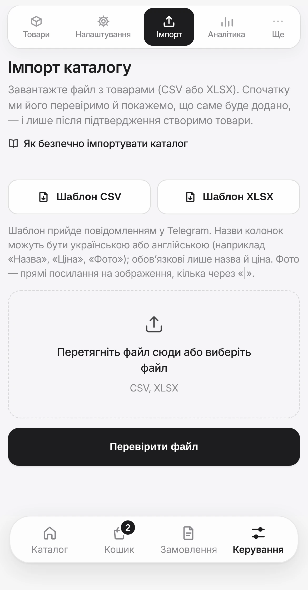
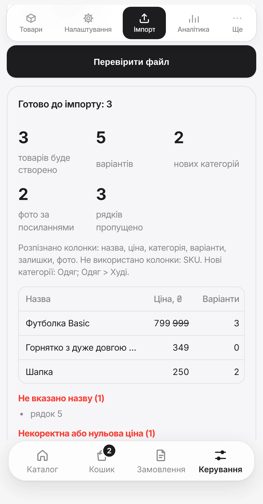

# Імпорт каталогу

Завантажте всі товари одним файлом замість того, щоб додавати їх по одному. Система спочатку перевіряє файл і показує, що саме буде додано, — і лише після вашого підтвердження створює товари. Помилились — імпорт можна скасувати.

!!! info "Де знаходиться"
    `Керування` → `Ще` → `Імпорт` (або кнопка `Імпорт товарів` на екрані `Товари`). Потрібен тариф **Pro** або вище; на нижчому тарифі вкладки немає.

---

## Як це працює

**1. Візьміть шаблон.** Натисніть `Шаблон CSV` або `Шаблон XLSX` — файл-приклад прийде вам у Telegram. Або завантажте готові приклади нижче.

**2. Заповніть.** Відкрийте файл в Excel, Google Таблицях чи Numbers, замініть приклади своїми товарами. Перший рядок із назвами колонок не видаляйте.

**3. Збережіть.** Для CSV оберіть кодування UTF-8 (в Excel це `CSV UTF-8 (розділений комами)`), інакше українські літери зіпсуються. XLSX зберігається як є.

**4. Перевірте.** Оберіть файл і натисніть `Перевірити файл`. Нічого ще не створюється.

**5. Підтвердіть.** Натисніть кнопку з кількістю товарів, наприклад `Імпортувати 5 товарів`.

**6. Передумали?** Одразу після імпорту — `Скасувати цей імпорт`.

{ .phone }

**Приклади файлів на 5 товарів** — з варіантами й залишками, знижкою, категорією з підкатегорією, товаром «під замовлення» й прихованим товаром:

- [products-import-5-items.csv](assets/examples/products-import-5-items.csv)
- [products-import-5-items.xlsx](assets/examples/products-import-5-items.xlsx)

!!! tip "Безпечний спосіб імпорту"
    Не заливайте одразу весь каталог. Візьміть файл на 5–10 позицій, імпортуйте, а потім відкрийте кілька товарів руками і перевірте: назва, ціна, категорія, фото, режим залишків. Якщо все правильно — заливайте решту.

---

## Що ви побачите після «Перевірити файл»

Система показує:

- скільки товарів і варіантів **буде створено**, скільки рядків пропущено;
- які колонки **розпізнано**, а які не використано;
- які **нові категорії** з'являться;
- перші рядки таблицею — щоб звірити назву, ціну, варіанти й кількість фото;
- **помилки** (рядок пропущено — червоним) і **зауваження** (рядок додасться, але є на що глянути), згруповані за типом, із номерами рядків.

Якщо все влаштовує — `Імпортувати …`. Якщо ні — виправте файл і натисніть `Перевірити файл` ще раз, або `Скасувати`.

{ .phone }

---

## Які колонки заповнювати

Обов'язкові лише **назва** і **ціна**. Решту можна залишити порожніми або видалити з файлу. Назви колонок можна писати англійською (як у шаблоні) **або українською** — великі й малі літери не важливі. Якщо якусь колонку не розпізнано, `Перевірити файл` скаже, яку саме не буде використано.

| Колонка | Що вписати |
|---|---|
| `name` _Назва, Товар_ | Назва товару. **Обов'язково.** Приклад: `Худі Oversize` |
| `price_uah` _Ціна, Вартість_ | Ціна в гривнях, більша за нуль. Підійде `1299`, `1 299`, `1299,50`, `1299 грн`; копійки округлюються. **Обов'язково.** Приклад: `1899` |
| `compare_at_price_uah` _Стара ціна_ | Ціна до знижки. Має бути вищою за звичайну, інакше її буде проігноровано. Приклад: `2299` |
| `description` _Опис_ | Опис товару |
| `category` _Категорія, Група_ | Категорія. Для підкатегорії напишіть `Розділ > Підрозділ`. Якщо такої категорії ще немає, її буде створено. Приклад: `Одяг > Худі` |
| `inventory_mode` _Облік_ | `tracked` (`Відстежувати залишки`) або `untracked` (`Без ліміту залишку`). Якщо залишити порожнім: з варіантами й залишками буде `tracked`, в усіх інших випадках `untracked` |
| `option_label` _Назва варіанта_ | Як називається вибір: `Розмір`, `Колір`, `Об'єм` |
| `options` _Варіанти, Розміри_ | Самі варіанти через <code>&#124;</code> Приклад: <code>S&#124;M&#124;L&#124;XL</code> |
| `stocks` _Залишки, Кількість_ | Залишки в тому ж порядку, що й варіанти, через <code>&#124;</code> Приклад: <code>6&#124;10&#124;8&#124;3</code> |
| `photos` _Фото, Зображення_ | Прямі посилання на фото через <code>&#124;</code>, до 10 штук. [Дивіться розділ «Фото»](#фото) Приклад: `https://a.com/1.jpg` |
| `is_active` _Активний, Показувати_ | `так` — товар видно в каталозі, `ні` — приховано |

Під назвою колонки курсивом — інші назви, які теж розпізнаються (їх можна писати українською).

---|---|---|---|
| `name` | `Назва`, `Товар`, `Назва товару` | Назва товару. **Обов'язково** | `Худі Oversize` |
| `price_uah` | `Ціна`, `Вартість`, `Ціна грн` | Ціна в гривнях, більша за нуль. Підійде `1299`, `1 299`, `1299,50`, `1299 грн`; копійки округлюються. **Обов'язково** | `1899` |
| `compare_at_price_uah` | `Стара ціна`, `Ціна до знижки` | Ціна до знижки. Має бути вищою за звичайну, інакше її буде проігноровано | `2299` |
| `description` | `Опис` | Опис товару | `Щільний футер з начосом` |
| `category` | `Категорія`, `Група` | Категорія. Для підкатегорії напишіть `Розділ > Підрозділ`. Якщо такої категорії ще немає, її буде створено | `Одяг > Худі` |
| `inventory_mode` | `Облік` | `tracked` (`Відстежувати залишки`) або `untracked` (`Без ліміту залишку`). Якщо залишити порожнім: з варіантами й залишками буде `tracked`, в усіх інших випадках `untracked` | `tracked` |
| `option_label` | `Назва варіанта` | Як називається вибір | `Розмір` |
| `options` | `Варіанти`, `Розміри`, `Розмір` | Самі варіанти через <code>&#124;</code> | <code>S&#124;M&#124;L&#124;XL</code> |
| `stocks` | `Залишки`, `Кількість` | Залишки в тому ж порядку, що й варіанти, через <code>&#124;</code> | <code>6&#124;10&#124;8&#124;3</code> |
| `photos` | `Фото`, `Зображення`, `Картинки` | Прямі посилання на фото через <code>&#124;</code>, до 10 штук. [Дивіться розділ «Фото»](#фото) | <code>https://a.com/1.jpg</code> |
| `is_active` | `Активний`, `Показувати` | `так` — товар видно в каталозі, `ні` — приховано | `так` |

---

## Кілька значень в одній клітинці

Варіанти, залишки й фото записуються в одну клітинку, тому їх потрібно розділяти. Найнадійніше — вертикальна риска `|` (на клавіатурі зазвичай над Enter, з Shift): `S|M|L`.

Працюють також крапка з комою (`S;M;L`), кома (`S,M,L`) і перенос рядка всередині клітинки (`Alt+Enter` в Excel). Але **в одній клітинці використовуйте лише один вид роздільника**. Якщо в назві варіанта є кома, наприклад `1,5 л`, розділяйте варіанти саме через `|`: `0,5 л|1,5 л`.

---

## Варіанти й залишки

Перший залишок належить першому варіанту, другий — другому і так далі.

| `options` | `stocks` | Що вийде |
|---|---|---|
| <code>S&#124;M&#124;L</code> | <code>6&#124;10&#124;8</code> | S — 6 шт., M — 10 шт., L — 8 шт. |
| <code>42&#124;43</code> | <code>3&#124;0</code> | 42 — 3 шт., 43 — немає в наявності |
| <code>150 мл&#124;300 мл</code> | порожньо | Товар «без ліміту залишку» з двома варіантами |

Залишків можна не вказувати, якщо товар продається без ліміту. Якщо залишків менше, ніж варіантів, решта отримає 0. Для зручності підійде й запис `S:6|M:10|L:8` в одній колонці `options`.

!!! warning "Товар із відстеженням залишків без варіантів не купити"
    Якщо вказати `tracked`, але не вказати варіанти й залишки, товар створиться, проте покупець не зможе його замовити. `Перевірити файл` попередить про такі рядки. Для товарів без розмірів і кольорів вказуйте `untracked` або просто залишайте колонку порожньою.

---

## Фото

У файл імпорту можна додати **лише посилання на фото в інтернеті**. Фотографії з комп'ютера чи телефона до файлу вставити не можна — ні в CSV, ні в XLSX.

**Посилання має бути прямим**: якщо відкрити його в браузері, ви бачите лише саму картинку, без сторінки навколо і без входу в акаунт. Зазвичай такі посилання закінчуються на `.jpg`, `.png` або `.webp`.

| Підійде | Не підійде |
|---|---|
| Фото на вашому сайті чи хостингу зображень | Google Диск, Dropbox, iCloud |
| Пряме посилання на файл (`…/photo.jpg`) | Сторінки в Instagram, OLX, Vinted, Telegram-каналі |
| | Посилання, що вимагають входу в акаунт |

Як це працює: товар створюється одразу, а фото підтягуються у фоні й з'являються в товарі за кілька хвилин. Якщо посилання не вдалося завантажити, товар залишається, а фото потрібно додати вручну.

!!! tip "Як додати фото з комп'ютера або телефона"
    Імпортуйте товари без фото, потім відкрийте товар, у блоці `Фото товару` натисніть `Додати фото` і оберіть знімки з галереї телефона або з папки на комп'ютері. Можна вибрати відразу кілька.

---

## Повторний імпорт і дублікати

Якщо в каталозі вже є товар із такою самою назвою (великі й малі літери та зайві пробіли не враховуються), рядок із файлу пропускається. Тому виправлений файл можна безпечно завантажити ще раз: уже додані товари не задвояться.

Якщо потрібно додати такі товари все одно, увімкніть галочку `Додавати й товари, назви яких уже є в каталозі` — кількість у перевірці оновиться.

!!! note "Імпорт лише додає товари"
    Імпорт не змінює ціни, залишки чи фото товарів, які вже є в каталозі. Для таких змін відкривайте товар і редагуйте його.

---

## Результат і скасування

Після `Імпортувати …` ви побачите підсумок: скільки товарів, варіантів і категорій створено, скільки рядків пропущено.

Кнопка **`Скасувати цей імпорт`** (потрібно підтвердити другим натисканням) приховує всі товари, додані цим імпортом. Це можна зробити протягом **7 днів**. Створені імпортом категорії залишаються.

{ .phone }

---

## Обмеження

- до **5 МБ** і до **2000 товарів** в одному файлі — більший каталог діліть на частини;
- для кожного товару потрібні назва й ціна більша за нуль, інакше рядок пропускається;
- у XLSX дані мають бути на першому аркуші;
- скільки товарів можна тримати в магазині, визначає ваш тариф — дивіться [Підписка](owner-guide.md#підписка);
- за хвилину можна виконати обмежену кількість перевірок і імпортів — якщо побачите «Забагато спроб», зачекайте хвилину.

---

## Що означають зауваження після перевірки

??? question "Список зауважень і помилок"
    **Помилки — рядок не буде додано:**

    - **Не вказано назву** — заповніть колонку з назвою.
    - **Некоректна або нульова ціна** — вкажіть ціну числом, більшою за нуль.
    - **Надто велика ціна** — перевірте, чи не зайві нулі.

    **Зауваження — рядок буде додано, але гляньте на нього:**

    - **Товар з такою назвою вже є в каталозі / назва повторюється у файлі** — рядок пропущено, щоб не створити дубль.
    - **Це не схоже на посилання на фото** — це фото пропущено, товар буде додано без нього.
    - **Забагато фото** — взято перші 10.
    - **Не вказано залишки** — варіанти отримають 0 шт., доки ви не вкажете кількість.
    - **Залишків менше, ніж варіантів** — решта варіантів матиме 0 шт.
    - **Облік залишків увімкнено, але немає варіантів** — товар не можна буде замовити.
    - **Залишок без варіантів не враховано** — кількість нема до чого прив'язати.
    - **Стара ціна має бути вищою за ціну** — знижку не додано.
    - **Ціну округлено** — у каталозі ціна в цілих гривнях.
    - **Категорії бувають двох рівнів** — третій і далі рівні відкинуто.
    - **Назву або опис скорочено** — перевищено допустиму довжину.

??? question "Помилки, які можуть з'явитися замість перевірки"
    - **Файл завеликий / забагато рядків** — розділіть каталог на кілька файлів.
    - **Не вдалося прочитати CSV** — збережіть файл у кодуванні UTF-8.
    - **Не вдалося відкрити файл** — перевірте, що він не пошкоджений і це справді CSV або XLSX.
    - **Не знайдено колонок з назвою та ціною** — завантажте шаблон і скопіюйте дані в нього.
    - **Імпорт уже виконується** — зачекайте, поки завершиться попередній.
