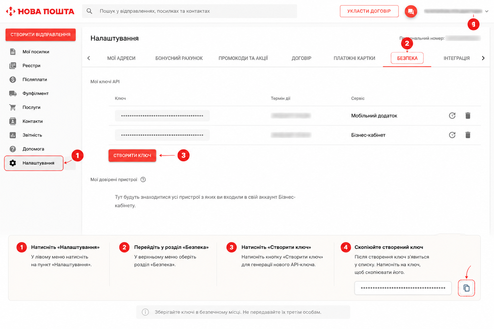
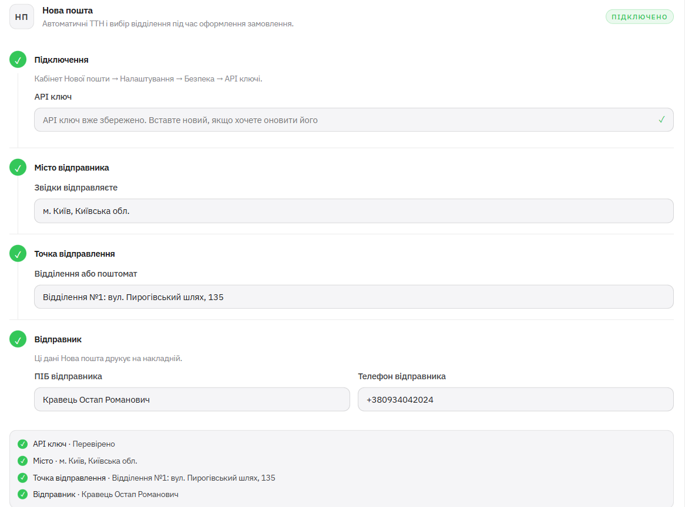

# Нова пошта

Коли Нова пошта підключена, ТТН створюється прямо із картки замовлення — одним дотиком, без переходу в кабінет перевізника. Налаштування займає близько пʼяти хвилин.

---

## Крок 1. Отримайте API ключ

1. Перейдіть на [new.novaposhta.ua](https://new.novaposhta.ua/).
2. Увійдіть у свій кабінет.
3. Відкрийте **Налаштування** → **Безпека** → `Створити Ключ`.
4. Скопіюйте `API ключ`.

---

## Крок 2. Внесіть дані в магазин

Відкрийте `Керування` → `Налаштування` → `Доставка` → картка **Нова пошта**.

Порядок дій має значення — виконуйте саме так:

**1.** Вставте `API ключ` і натисніть `Зберегти API ключ`.

**2.** У полі `Місто відправника` натисніть `Знайти місто`, введіть назву і **виберіть місто зі списку**.

**3.** У полі `Точка відправлення` натисніть `Знайти точку відправлення`, знайдіть своє відділення або поштомат і **виберіть його зі списку**.

**4.** Заповніть `ПІБ відправника`.

**5.** Заповніть `Телефон відправника`.

**6.** Натисніть `Зберегти доставку`.

!!! warning "Найчастіша помилка при налаштуванні"
    Місто і точку відправлення **не можна вводити текстом вручну**. Їх треба знайти через кнопки пошуку і вибрати зі списку, що випадає.

    Причина: разом із назвою система зберігає внутрішній ідентифікатор Нової пошти. Якщо ви просто набрали «Київ» руками — ідентифікатора немає, і ТТН не створиться, хоча в полі буде правильний текст.

    Якщо не впевнені, чи вибирали зі списку — натисніть `Скинути налаштування` і пройдіть кроки заново.

---

## Що має бути заповнено

Пʼять обовʼязкових значень:

- [ ] `API ключ` Нової пошти
- [ ] `Місто відправника` — вибране зі списку
- [ ] `Точка відправлення` — вибрана зі списку
- [ ] `ПІБ відправника`
- [ ] `Телефон відправника`

Плюс сам модуль Нової пошти має бути увімкнений у `Налаштування` → `Модулі`.

---

## Як створити ТТН

Після налаштування в картці замовлення зʼявляється кнопка `🚚 Створити ТТН`.

1. Відкрийте замовлення — у боті через `📋 Замовлення` або командою `/orders`.
2. Натисніть `🚚 Створити ТТН`.
3. Після створення зʼявиться кнопка `🔎 Відстежити` — вона веде на трекінг Нової пошти.
4. Для накладеного платежу позначте замовлення кнопкою `🚚 Відправлено`.

---

## Умови, за яких ТТН створюється без помилки

Пʼять умов мають виконуватися **одночасно**:

| # | Умова | Де перевірити |
|---|---|---|
| 1 | Модуль Нової пошти увімкнений | `Налаштування` → `Модулі` |
| 2 | API ключ збережений | `Налаштування` → `Доставка` |
| 3 | Заповнені дані відправника | `Налаштування` → `Доставка` |
| 4 | Місто і точка вибрані зі списків пошуку | `Налаштування` → `Доставка` |
| 5 | У замовленні є коректні дані отримувача з містом і відділенням | Картка замовлення |

---

## Якщо щось не працює

??? question "Кнопка «Створити ТТН» не зʼявляється"
    Швидше за все, модуль Нової пошти вимкнений або не збережений API ключ.

    Перевірте `Налаштування` → `Модулі`, потім `Налаштування` → `Доставка`.

??? question "ТТН не створюється, хоча все заповнено"
    Найчастіші причини, у порядку ймовірності:

    1. **Місто або точка відправлення введені вручну**, а не вибрані зі списку. Натисніть `Скинути налаштування` і пройдіть кроки заново.
    2. **У замовленні немає повних даних отримувача** — місто або відділення покупець вказав некоректно.
    3. Телефон відправника у неправильному форматі.

??? question "Помилка авторизації або «невірний ключ»"
    Ключ міг бути видалений або деактивований у кабінеті Нової пошти. Створіть новий: **Налаштування** → **Безпека** → `Створити Ключ`, вставте його в магазин і натисніть `Зберегти API ключ`.

??? question "Хочу почати налаштування з нуля"
    У картці **Нова пошта** є кнопка `Скинути налаштування`. Вона очищає збережені значення, після чого можна пройти всі кроки заново.
