# Інструкція для власника

Цей гайд проведе вас від створення магазину до стабільно працюючих продажів. Кожен розділ — окрема задача, яку можна закрити за один підхід. Усі знімки екрана — з мобільної версії: саме так магазином керує більшість власників.

!!! tip "Якщо ви тут вперше"
    Не читайте все підряд. Пройдіть [Швидкий старт](#швидкий-старт) — цього достатньо, щоб прийняти перше замовлення. Решту розділів відкривайте тоді, коли дійде черга.

**Куди йти за потрібною задачею**

| Я хочу… | Розділ |
|---|---|
| створити магазин і зайти в адмінку | [Швидкий старт](#швидкий-старт) |
| додати товари, фото, знижки | [Каталог](#каталог) |
| завантажити багато товарів файлом | [Імпорт каталогу](#імпорт-каталогу) |
| прийняти оплату від покупців | [Оплати](payments.md) |
| відправляти замовлення Новою поштою | [Нова пошта](nova-poshta.md) |
| змінити кольори, банер, шрифти | [Вигляд магазину](#вигляд-магазину) |
| обробляти замовлення | [Замовлення](#замовлення) |
| дізнатися про тарифи й обмеження | [Підписка](#підписка) |
| повернути покупців, розіслати акцію | [Модулі зростання](#модулі-зростання) |
| зрозуміти, чому щось не працює | [Часті ситуації](#часті-ситуації) |

---

## Швидкий старт

Десять кроків до першого продажу. Робіть їх у цьому порядку — кожен наступний спирається на попередній. Весь шлях займає близько години, не враховуючи очікування банку.

**1. Створіть магазин.** Відкрийте бота платформи Cartium і натисніть `🛍️ Створити мій магазин` (або надішліть `/connect`). Бот попросить **назву магазину** і **токен Telegram-бота** — окремого бота, через якого працюватимуть ваші покупці. Токен ви отримаєте в @BotFather — докладніше під списком кроків. Пробний період — **14 днів**.

**2. Зайдіть в адмінку.** Відкрийте щойно створеного бота магазину й надішліть `/admin`.

**3. Прийміть документи.** Якщо бот попросить — натисніть `✅ Приймаю` для політики конфіденційності та правил використання. Без цього адмін-меню не відкриється.

**4. Створіть категорії.** У боті: `/admin` → `📂 Категорії` → `➕ Додати категорію`. Спочатку категорії, потім товари — інакше доведеться перекладати товари руками.

**5. Додайте товари.** WebApp: `Керування` → `Товари` → `Додати товар`. Назва, ціна, фото, категорія. Якщо у товару є розміри чи кольори — заводьте їх варіантами. Багато товарів? Скористайтеся [імпортом](#імпорт-каталогу).

**6. Підключіть оплату.** Достатньо одного робочого способу. Онлайн-еквайринг підключається на стороні банку й може зайняти кілька днів — подайте заявку якомога раніше. Деталі — на сторінці [Оплати](payments.md).

**7. Налаштуйте доставку.** Якщо працюєте з Новою поштою — внесіть API ключ і дані відправника. Деталі — [Нова пошта](nova-poshta.md).

**8. Оформіть магазин.** Логотип, банер, кольори, шаблон — розділ [Вигляд магазину](#вигляд-магазину).

**9. Пройдіть тестове замовлення повністю.** Як покупець: каталог → кошик → оформлення → оплата → замовлення прийшло вам в адмінку → доставка.

**10. Перевірте підписку.** Пробний період триває 14 днів — оберіть тариф у `Налаштування` → `Підписка`, щоб магазин не зупинився.

??? example "Як створити бота в @BotFather і отримати токен"
    1. Відкрийте @BotFather у Telegram (кнопка `Відкрити @BotFather` є в повідомленні бота Cartium) і надішліть `/newbot`.
    2. **Назва бота** — те, що бачать покупці в чатах і пошуку, наприклад `Urban Style`.
    3. **Username бота** — унікальна адреса: латиниця, цифри та `_`, від 5 до 32 символів, обов'язково закінчується на `bot`, наприклад `urbanstyle_bot`.
    4. BotFather надішле **токен** — рядок на кшталт `123456789:AAH…`. Скопіюйте його повністю й надішліть боту Cartium в чат.

    Повідомлення з токеном бот Cartium одразу видаляє, а в системі токен зберігається лише в зашифрованому вигляді. Нікому більше токен не надсилайте: він дає повний доступ до бота. Для кожного магазину потрібен окремий бот.

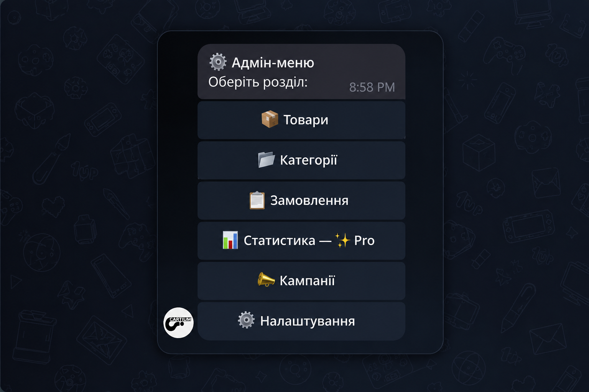{ .phone }
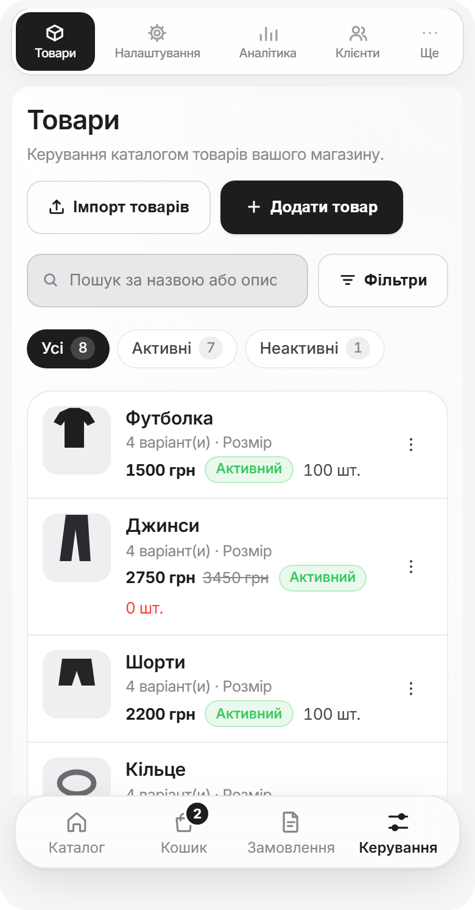{ .phone }

!!! warning "Не починайте з модулів росту"
    Промокоди, кампанії, аналітика і крос-продажі не врятують магазин, у якому не працює базове. Спочатку доведіть до кінця ланцюжок:

    `товар → кошик → оформлення → оплата → замовлення → відправка`

    І тільки потім вмикайте решту.

---

## Два інтерфейси магазину

Це один магазин, до якого можна дістатися двома шляхами. Просте правило: **одну дію швидко — у боті, системну роботу — у WebApp.**

### Telegram-бот

Бот — це швидкі дії. Відкрили, зробили одну справу, закрили.

Після `/admin` ви бачите меню:

| Кнопка | Для чого |
|---|---|
| `📦 Товари` | Список товарів, додати або відредагувати |
| `📂 Категорії` | Створити категорії та підкатегорії, змінити порядок |
| `📋 Замовлення` | Нові замовлення, підтвердження оплат, ТТН |
| `📊 Статистика —✨Pro` | Показники магазину з експортом у CSV та Excel |
| `📣 Кампанії` | Розсилки — з'являється, якщо модуль доступний за вашим тарифом |
| `⚙️ Налаштування` | Базові налаштування магазину |

Унизу екрана також є постійна клавіатура: `🏠 Старт`, `🗂 Каталог`, а для адміністратора ще `⚙️ Admin`, `📦 Товари`, `📑 Замовлення`.

### WebApp магазину

WebApp — це робочий кабінет. Відкривається кнопкою з бота. Унизу — панель із чотирьох розділів:

| Розділ | Що там |
|---|---|
| `Каталог` | Вітрина — те саме, що бачить покупець |
| `Кошик` | Кошик (для перевірки оформлення «очима покупця») |
| `Замовлення` | Список замовлень із пошуком і фільтрами |
| `Керування` | Ваш адмінський розділ. Усе найважливіше — тут |

Усередині `Керування` зверху — ряд вкладок. На телефоні частину з них сховано в меню `Ще`.

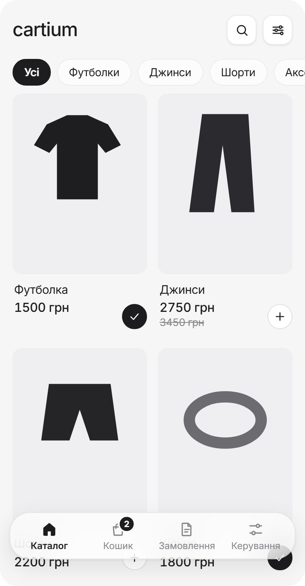{ .phone }

!!! info "Часте непорозуміння"
    Іноді власники шукають вкладки «Промокоди» чи «Аналітика» у нижньому меню і не знаходять. Вони не там: спочатку відкрийте `Керування`, і вже всередині побачите повний набір вкладок.

### Що всередині розділу «Керування»

| Вкладка | Що там |
|---|---|
| `Товари` | Каталог, пошук, швидке редагування, форма створення |
| `Налаштування` | Підписка, оплати, доставка, вигляд, команда, контент |
| `Аналітика` | Показники магазину за періодами |
| `Клієнти` | База клієнтів, сегменти |
| `Ще` → `Імпорт` | Масове завантаження товарів файлом CSV або XLSX |
| `Ще` → `Промокоди` | Знижки, обмеження, сегменти аудиторії |
| `Ще` → `Кампанії` | Розсилки по базі клієнтів |
| `Ще` → `Крос-продажі` | Рекомендації супутніх товарів |

На широких екранах (комп'ютер) усі вкладки видно в один ряд.

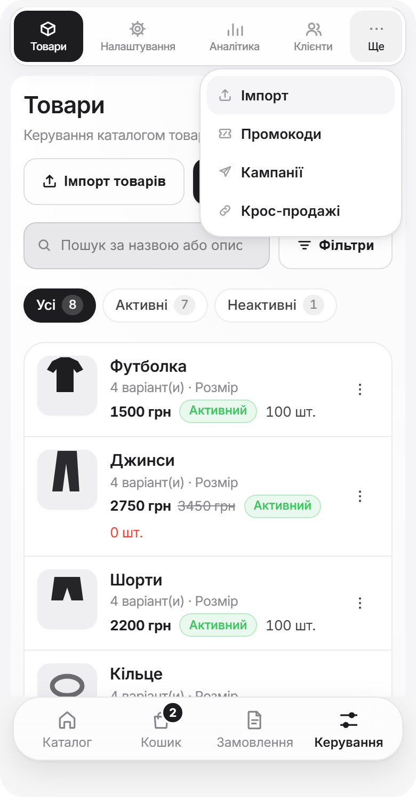{ .phone }

!!! question "Чому я бачу менше вкладок, ніж у списку?"
    Вкладки з'являються лише тоді, коли відповідний модуль увімкнений **і** дозволений вашим тарифом. Якщо доступ обмежений — залишаються `Товари` і `Налаштування`. Перевірити можна в `Налаштування` → `Модулі`.

---

## Команди бота

Більшість власників знають тільки `/admin`. Насправді команд більше, і деякі економлять час.

### Ваші робочі команди

| Команда | Що робить |
|---|---|
| `/admin` | Відкриває адмін-меню |
| `/orders` | Одразу список замовлень, без заходу в меню |
| `/order` | Картка конкретного замовлення |
| `/markpaid` | Позначити замовлення оплаченим |
| `/addproduct` | Швидко додати товар |
| `/guide` | Інтерактивна інструкція просто в боті |
| `/myid` | Показує ваш числовий Telegram ID |

### Команди, які бачить покупець

`/start`, `/catalog`, `/cart`, `/myorders`, `/cancel`, `/skip`

Варто знати їх, щоб розуміти, що саме описує клієнт у зверненні до підтримки.

!!! tip "Якщо застрягли посеред сценарію"
    Бот веде вас покроково — наприклад, при додаванні товару. Якщо передумали, надішліть `/cancel`. Якщо крок необов'язковий і хочете його пропустити — `/skip`.

---

## Хто за що відповідає

### Ви як власник магазину

Все, що стосується щоденної роботи:

| Зона | Що саме |
|---|---|
| Каталог | Категорії, товари, фото, варіанти, залишки, знижки, активність |
| Замовлення | Перегляд, підтвердження оплат, відправки, статуси |
| Оплати | LiqPay, plata by mono, за посиланням, за реквізитами, післяплата |
| Доставка | Нова пошта, дані відправника, ТТН |
| Контент | Тексти магазину, назви кнопок |
| Вигляд | Шаблон, кольори, шрифти, логотип, банер |
| Зростання | Промокоди, кампанії, аналітика, крос-продажі, сегменти |
| Команда й підписка | Адміни магазину, тариф, режим доступу |

### Платформний адміністратор

Потрібен тільки тоді, коли проблема не вирішується з вашої адмінки:

- бот зовсім не відповідає;
- магазин не відкривається;
- проблема з доступом на рівні платформи;
- потрібні технічні зміни поза інтерфейсом магазину.

!!! info "Коли писати платформному адміну"
    Якщо ви можете зайти в `/admin` і бачите меню — швидше за все, питання вирішується налаштуваннями, і цей гайд допоможе. Пишіть платформному адміну, коли не працює сам вхід.

---

## Каталог

### Де зручніше працювати

**У боті:** `/admin` → `📦 Товари` або `📂 Категорії` — коли треба швидко щось поправити. **Категорії створюються лише тут** (а також автоматично при імпорті).

**У WebApp:** `Керування` → `Товари` — коли працюєте системно. Там є пошук, фільтри, список зі статусами й залишками та повна форма створення.

{ .phone }
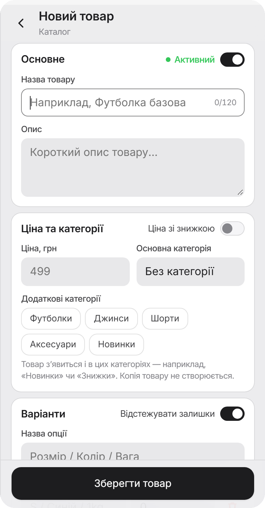{ .phone }

У рядку товару кнопка `⋮` відкриває меню: `Редагувати`, `Дублювати`, `Деактивувати` / `Активувати`. «Дублювати» зручно, коли треба завести схожий товар.

### Спочатку категорії

Створіть структуру категорій до того, як заводити товари. Підтримуються підкатегорії — в боті можна змінювати порядок кнопками `⬆️ Підняти` і `⬇️ Опустити`.

Це не косметика: від структури категорій залежить, чи знайде покупець потрібне за два дотики, чи гортатиме стрічку з сотні позицій.

### Форма товару

| Блок і поле | Коментар |
|---|---|
| `Активний` | Вимкніть, щоб тимчасово прибрати товар з вітрини |
| `Назва товару`, `Опис` | Назва — те, що покупець бачить першим. Не пишіть в опис розміри й кольори — для цього є варіанти |
| `Ціна, грн` | Ціна, яку платить покупець |
| `Ціна зі знижкою` | Увімкніть, і з'явиться поле `Звичайна ціна, грн` — стара ціна, яка показується закресленою. Відсоток знижки рахується сам |
| `Основна категорія` | Обов'язково, інакше товар важко знайти |
| `Додаткові категорії` | Той самий товар у кількох категоріях — наприклад, «Новинки» чи «Знижки». Копія не створюється |
| `Відстежувати залишки`, `Назва опції`, `Значення` / `Залишок, шт.` | Варіанти: розмір, колір, об'єм. Кнопка `Додати варіант` |
| `Показувати, коли немає в наявності` | Вимкніть — і товар зникне з каталогу та пошуку, доки не з'являться залишки |
| `Фото товару` | До **10** фото. Кнопка `Додати фото` |

Збереження — кнопка `Зберегти товар` внизу.

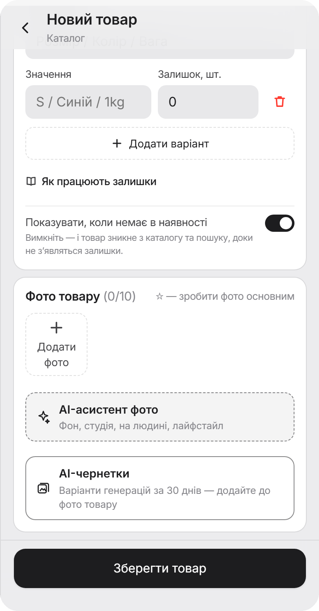{ .phone }

### Фото

Один товар — до десяти фото. Практичне правило:

- **перше фото — головне.** Саме воно тягне на себе увагу в стрічці каталогу; щоб зробити інше фото головним, натисніть `☆` на ньому;
- решта — деталі, кольори, фактура, масштаб;
- якщо ліміт вичерпано, спочатку видаліть зайве, потім додавайте нове;
- додавайте фото кнопкою `Додати фото` в блоці `Фото товару`: можна вибрати знімки з галереї телефона або з комп'ютера, одразу кілька.

**AI-асистент фото.** Під фото є кнопка `AI-асистент фото` (фон, студія, на людині, лайфстайл): ви обираєте дію, асистент готує варіант, а ви вирішуєте, чи додавати його до товару. Готові варіанти зберігаються 30 днів у `AI-чернетки`. Кожна генерація витрачає **AI-кредити** — щомісячний ліміт залежить від тарифу (див. [Підписка](#підписка)).

### Варіанти і залишки

Якщо товар має розміри, кольори чи об'єми — заводьте варіанти. Тоді покупець обирає значення у зрозумілому селекторі, а ви бачите залишки по кожній позиції окремо.

Система оперує двома поняттями:

- **залишок** — фактично доступна кількість;
- **резерв** — тимчасово відкладено під замовлення, які ще не завершені. Доступна кількість — це залишок мінус резерв.

### Режими залишків

| Режим | Що означає |
|---|---|
| `Відстежувати залишки` | Ви задаєте реальну кількість, система її списує |
| `Без ліміту залишку` | Жорсткий облік не ведеться, товар іде під замовлення |

!!! info "Товар з відстеженням залишків без варіантів купити не можна"
    Залишки рахуються по варіантах. Якщо ввімкнено облік, але жодного варіанта немає — покупцеві нічого замовляти. Для товарів без розмірів і кольорів оберіть `Без ліміту залишку` або заведіть один варіант із кількістю.

!!! warning "Важливе правило для товарів без ліміту залишку"
    Якщо товар продається в режимі `Без ліміту залишку`, для нього має бути увімкнена **хоча б одна онлайн-оплата**: `LiqPay`, `plata by mono`, `Оплата за посиланням` або `Оплата за реквізитами`.

    Якщо залишити тільки післяплату, оформлення такого товару буде заблоковане — покупець просто не зможе його купити.

### Імпорт каталогу

Потрібно завести десятки чи сотні товарів? Завантажте їх одним файлом CSV або XLSX: `Керування` → `Ще` → `Імпорт`. Спочатку система **перевіряє файл і показує, що буде додано** — і лише після вашого підтвердження створює товари. Повторне завантаження того самого файлу нічого не задвоює, а будь-який імпорт можна скасувати протягом 7 днів.

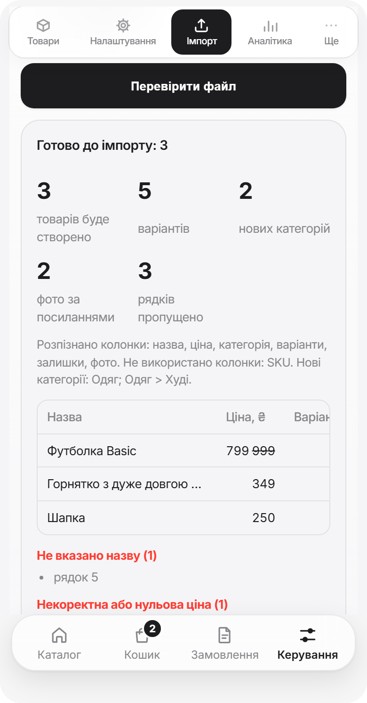{ .phone }

[Повна інструкція з імпорту: колонки, фото, приклади :material-arrow-right:](import.md){ .btn-link }

---

## Замовлення

### Де працювати

**У боті:** `/admin` → `📋 Замовлення` або одразу командою `/orders`. Для швидких дій бот залишається зручною точкою входу.

**У WebApp:** розділ `Замовлення` — розширений інтерфейс із пошуком, сортуванням і фільтрами. Зручніший для розбору великої кількості.

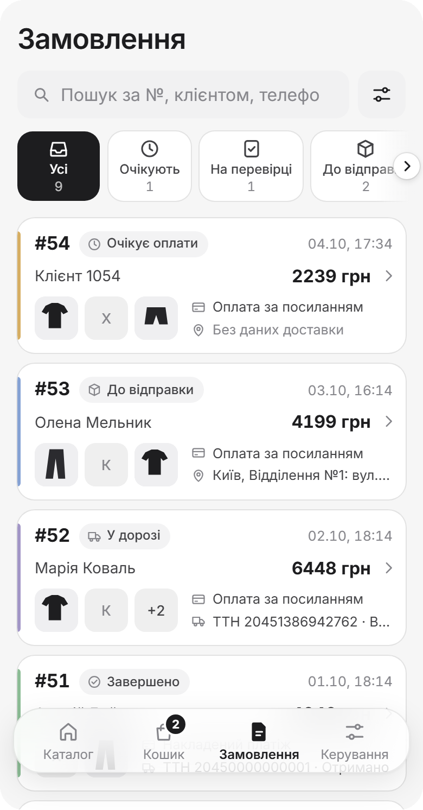{ .phone }
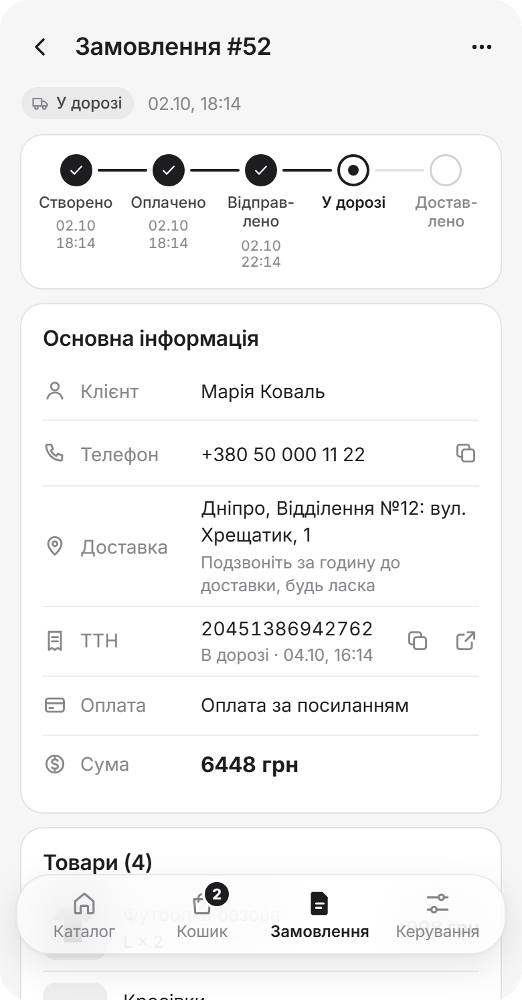{ .phone }

### Фільтри

Над списком — плитки-фільтри з лічильниками:

| Фільтр | Кого показує |
|---|---|
| `Усі` | Повний список |
| `Очікують` | Замовлення, де ще немає підтвердженої оплати |
| `На перевірці` | Клієнт натиснув «Я оплатив(ла)», потрібна ваша перевірка |
| `До відправки` | Оплачені або з післяплатою, готові до відправлення |
| `У дорозі` | Уже відправлені |
| `Завершені` | Закриті замовлення |

Пошук працює за номером, іменем клієнта чи телефоном. Праворуч від пошуку — сортування: `Спочатку нові`, `Спочатку старі`, `№ за спаданням`, `№ за зростанням`.

### Статуси: онлайн-оплата

| Статус | Що означає | Ваша дія |
|---|---|---|
| `⏳ Очікує оплати` | Замовлення створене, оплата не підтверджена | Зачекати |
| `🧾 Оплата на перевірці` | Клієнт натиснув `Я оплатив(ла)` | Перевірити надходження і підтвердити |
| `✅ Оплачено` | Оплата підтверджена | Відправляти |
| `❌ Скасовано` | Замовлення скасоване | — |
| `⌛ Прострочено` | Оплата не завершена вчасно | — |

### Статуси: післяплата

| Статус | Що означає | Ваша дія |
|---|---|---|
| `📦 Очікує відправки` | Замовлення створене, готове до відправлення | Створити ТТН і відправити |
| `🚚 Відправлено` | Посилку відправлено | Чекати на отримання |
| `📍 Очікує отримання` | Посилка у відділенні | Чекати |
| `✅ Оплачено` | Клієнт отримав і оплатив | Закрити |
| `❌ Скасовано` | Не забране або повернуте | — |

### Дії в картці замовлення

У картці внизу — головна кнопка (та, що найімовірніше потрібна зараз) і менші дії поруч; решта ховається в меню `…`. Значок `ⓘ` біля кнопки пояснює, що саме станеться (кому прийде повідомлення, чи спишуться залишки).

| Дія | Коли з'являється |
|---|---|
| `Підтвердити оплату` | Коли потрібна ручна перевірка оплати |
| `Створити ТТН` | Якщо налаштована Нова пошта і є дані отримувача |
| `Оновити статус ТТН`, `Відстежити`, `Скопіювати ТТН` | Після створення ТТН. `Відстежити` відкриває трекінг Нової пошти |
| `Перевипустити ТТН`, `Скасувати ТТН` | Якщо накладну треба виправити |
| `Позначити відправленим` | Для замовлень із післяплатою |
| `Позначити у відділенні` | Посилка прибула, чекає на клієнта |
| `Оплачено / отримано` | Клієнт забрав і оплатив посилку |
| `Скасувати / повернення` | Для скасування замовлення |

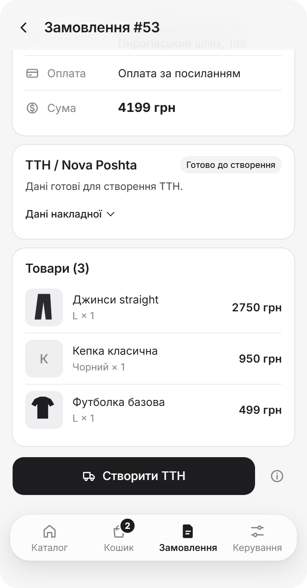{ .phone }
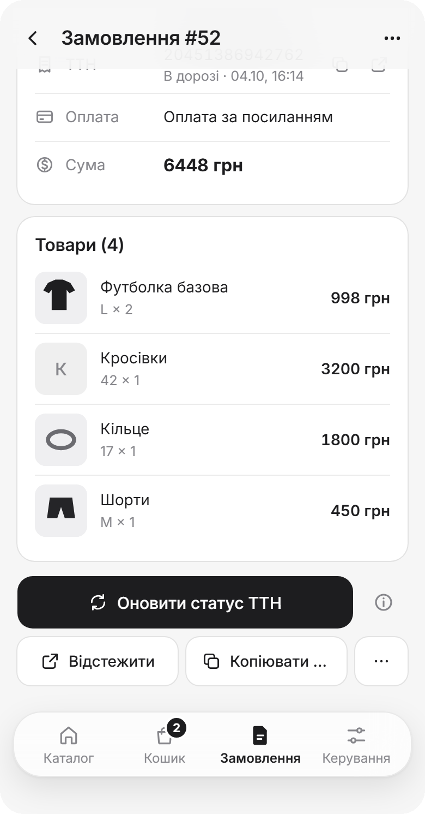{ .phone }

### Робоча звичка

Мінімум **двічі на день** перевіряйте два фільтри:

- `Очікують`
- `На перевірці`

Це найважливіше на старті магазину. Замовлення «на перевірці» — це людина, яка вже віддала гроші й чекає на підтвердження. Кожна година мовчання тут коштує вам довіри.

---

## Оплати

Платформа підтримує п'ять способів:

| Спосіб | Тип | Підтвердження |
|---|---|---|
| `LiqPay` | Онлайн-еквайринг | Автоматичне |
| `plata by mono` (Monobank) | Онлайн-еквайринг | Автоматичне |
| `Оплата за посиланням` | Банка або платіжна сторінка | Ручне |
| `Оплата за реквізитами` | Переказ на рахунок | Ручне |
| `Післяплата` | Оплата при отриманні на пошті | — |

Усе налаштовується в одному місці: `Керування` → `Налаштування` → `Оплати`. Кожен спосіб — окремий рядок із перемикачем і статусом (`Активний`, `Немає ключів`); натисніть на рядок, щоб відкрити його налаштування. Після змін натисніть `Зберегти зміни`.

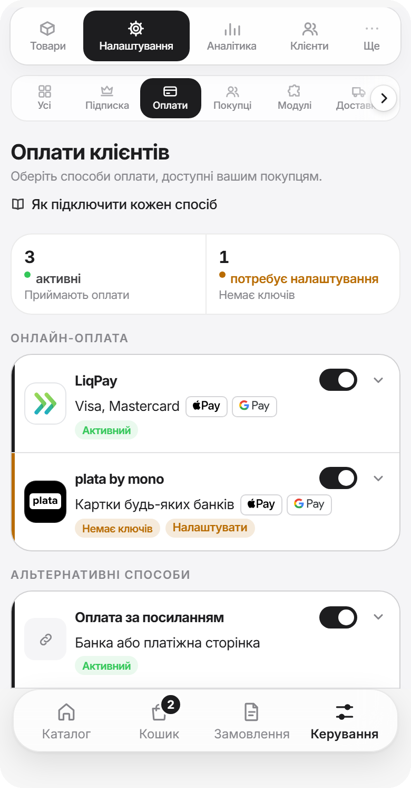{ .phone }

### Як це бачить покупець

- `💳 Оплатити онлайн через LiqPay` — картка, Apple Pay або Google Pay;
- `💳 Оплатити онлайн через Monobank` — насправді це еквайринг `plata by mono`: картка будь-якого банку, Apple Pay або Google Pay;
- `💳 Онлайн оплата` — оплата за вашим посиланням;
- `🏦 Банківські реквізити` — позначені бейджем `IBAN`;
- `📦 Накладений платіж` — оплата при отриманні;
- кнопка `Я оплатив(ла)` — для способів, де потрібна ваша ручна перевірка.

Для LiqPay і Monobank після успішної оплати замовлення підтверджується автоматично — вам нічого робити не треба.

[Покрокове підключення кожного способу :material-arrow-right:](payments.md){ .btn-link }

---

## Доставка

Нова пошта налаштовується в `Керування` → `Налаштування` → `Доставка`. Потрібен тариф **Pro** або вище.

Налаштування — це чотири кроки зверху вниз:

1. `API ключ` — вставте ключ з кабінету Нової пошти (як його створити — [тут](nova-poshta.md#крок-1-отримайте-api-ключ)).
2. `Місто відправника` — почніть вводити назву й **виберіть місто зі списку**.
3. `Точка відправлення` — відділення або поштомат, **теж зі списку**.
4. `ПІБ відправника` і `Телефон відправника` — вони друкуються на накладній.

Натисніть `Зберегти доставку`. Кнопка `Перевірити підключення` зробить пробний запит до Нової пошти з вашим ключем.

!!! warning "Не вводьте місто і відділення вручну"
    Ці значення мають вибиратися зі списків пошуку. Просто набраний текст не підійде — система не отримає внутрішні ідентифікатори Нової пошти, і ТТН не створиться.

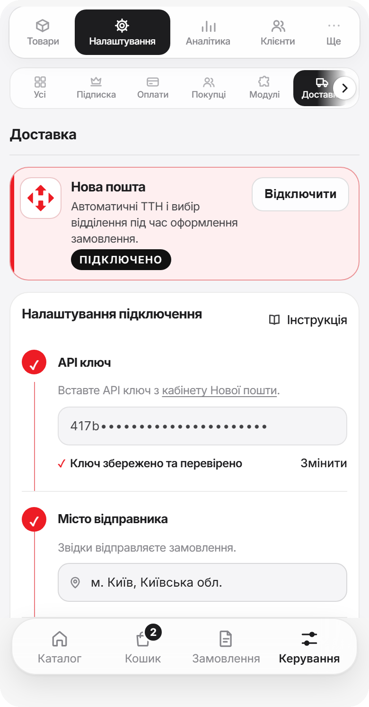{ .phone }

[Детальний гайд по Новій пошті :material-arrow-right:](nova-poshta.md){ .btn-link }

---

## Вигляд магазину

`Керування` → `Налаштування` → `Вигляд`. Редактор відкривається одразу; зверху — кнопка `Попередній перегляд`, щоб побачити магазин із новими налаштуваннями, а внизу — `Зберегти зміни` (і `Скасувати`).

Налаштування згруповані в розділи — відкривайте по одному:

| Розділ | Що змінюється |
|---|---|
| `Шаблон магазину` | Структура головної: розмір і розташування банерів, порядок секцій, вигляд сітки товарів |
| `Верхній рядок` | Біжуча строка з оголошенням (наприклад, про безкоштовну доставку), може вести на категорію, товар чи посилання |
| `Банер у шапці` | Назва магазину, текст або зображення (приблизно 1200×240 px) |
| `Категорії` | Стиль, розмір і кольори кнопок категорій |
| `Фон каталогу` | Колір або власне зображення (вертикальне, 1080×1920 px, до 20 МБ) |
| `Типографіка` | Шрифт, `Акцент тексту`, контраст інтерфейсу |
| `Кнопки та елементи` | Світла чи темна тема, `Акцент кнопок`, стиль кнопок і карток, скруглення, щільність, глибина тіней |

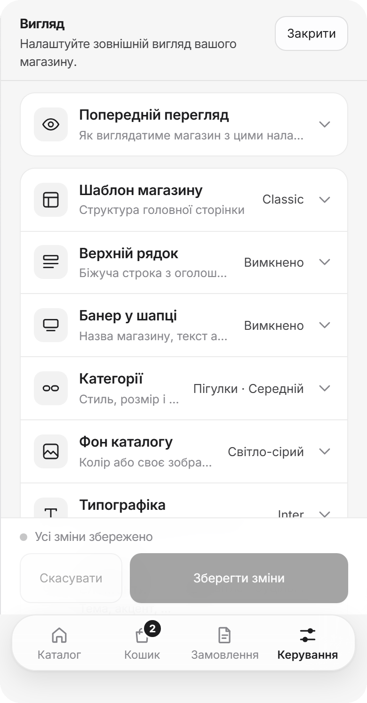{ .phone }

Кольори кнопок і тексту незалежні. Поки `Акцент тексту` порожній (кнопка `Авто`), колір посилань і активних вкладок підбирається автоматично від акценту кнопок. Для зображень є `Точка фокусу` — позначте, що має лишитися в кадрі, коли картинку обрізає вузький екран.

Після `Зберегти зміни` все одразу видно у вітрині — перезапускати магазин не потрібно. Кількість доступних шаблонів залежить від тарифу.

!!! tip "Не перестарайтеся"
    Найсильніше на сприйняття магазину впливають дві речі: якісні фото товарів і зрозумілий логотип. Ексклюзивні шрифти й тіні цього не замінять.

---

## Налаштування

`Керування` → `Налаштування`. Угорі — ряд категорій: `Усі`, `Підписка`, `Оплати`, `Покупці`, `Модулі`, `Доставка`, `Вигляд`, `Команда`, `Контент`. Ряд гортається вбік.

### `Підписка`

Тут ви бачите поточний тариф і керуєте доступністю магазину.

| | Basic | Pro | Business |
|---|---|---|---|
| Ціна, міс. | $10 | $20 | $40 |
| Ціна за рік | $96 | $192 | $384 |
| Шаблонів магазину | 1 | 3 | 10 |
| AI-кредитів на місяць | 20 | 100 | 300 |
| Імпорт, промокоди, кампанії, нагадування про кошик, кабінет покупця, клієнти й сегменти, аналітика, Нова пошта | — | ✔ | ✔ |
| Гнучкі сегменти клієнтів, крос-продажі | — | — | ✔ |

Річна оплата дешевша на 20%. Оплата — кнопка `Оплатити підписку`; перед першою оплатою потрібно підтвердити документи та умови. Історія платежів і договори — нижче на сторінці.

{ .phone }

Нові магазини отримують **14 днів** пробного періоду.

**Режими доступу магазину** — вибір внизу картки, застосовується кнопкою `Застосувати режим`:

| Режим | Що відбувається |
|---|---|
| `За статусом підписки` | Доступ визначається поточною підпискою — режим за замовчуванням |
| `Працює у звичайному режимі` | Магазин примусово активний |
| `Пауза checkout` | Каталог видно, але нові замовлення не оформлюються |
| `Магазин приховано для клієнтів` | Вітрина тимчасово недоступна |

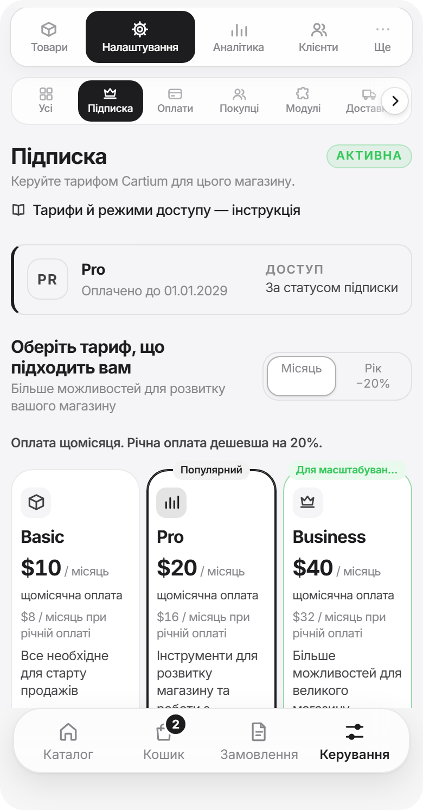{ .phone }

!!! tip "Коли стане в пригоді «Пауза checkout»"
    Поїхали у відпустку або закінчився товар — поставте паузу замість того, щоб ховати магазин повністю. Покупці далі бачать асортимент і повертаються, коли ви знімете паузу.

### `Оплати`

Описано вище й на сторінці [Оплати](payments.md).

### `Покупці`

Дві картки:

- **Нагадування про кошик** — автоматичне повідомлення покупцям, які залишили товари в кошику й не оформили замовлення. Ви задаєте верхню частину повідомлення та час відправки (30 хв, 6 год або 24 год), а нижче бачите приклад. Збереження — `Зберегти нагадування`;
- **Кабінет покупця** — вхід покупця за e-mail або Telegram, історія замовлень і бонуси.

### `Модулі`

Картка **Модулі магазину**. Тут вмикаються і вимикаються доступні модулі. Біля кожного — позначка: `Входить у тариф` або `Потрібен Pro` / `Потрібен Business`. Якщо якоїсь вкладки не видно — почніть перевірку звідси.

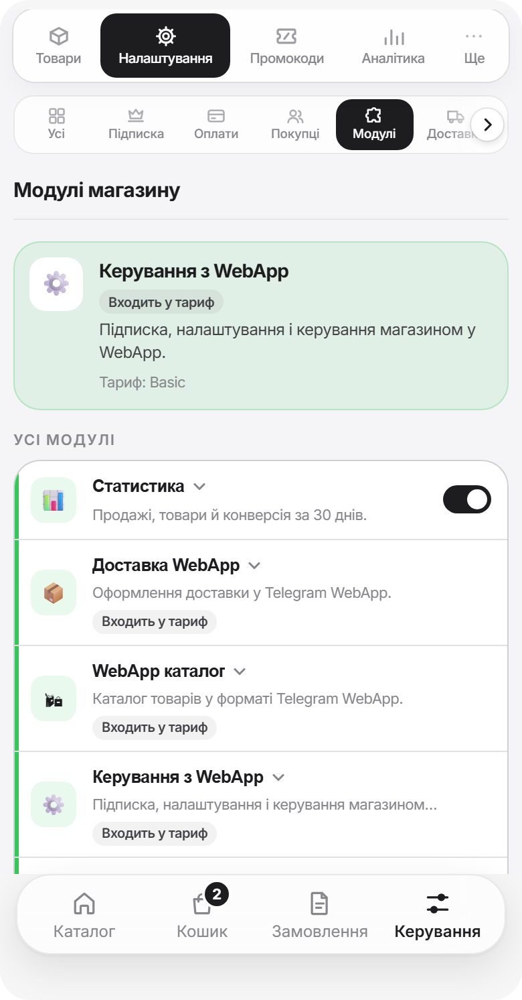{ .phone }

### `Доставка`

Картка **Нова пошта**. Описано вище.

### `Вигляд`

Описано в розділі [Вигляд магазину](#вигляд-магазину).

### `Команда`

Картка **Адміни магазину**. Щоб додати нового адміністратора, введіть його **числовий Telegram ID** у поле і натисніть `Додати`. Поряд є підказка `Як дізнатися Telegram ID`.

Щоб дізнатися ID, попросіть людину надіслати боту команду `/myid`.

### `Контент`

Дві картки:

- **Тексти магазину** — привітання, описи, службові повідомлення;
- **Кнопки та назви** — підписи кнопок і розділів.

---

## Модулі зростання

Ці інструменти працюють тоді, коли базовий магазин уже стабільний. Раніше вмикати їх немає сенсу. Більшість потребує тарифу Pro.

### Промокоди

`Керування` → `Ще` → `Промокоди`. Угорі — підсумок (скільки всього, активних, запланованих, завершених) і фільтри за статусом. `Створити` відкриває форму:

| Поле | Що задає |
|---|---|
| `Код` | Латинські літери, цифри, `_` та `-` |
| `Тип знижки`, `Значення` | `Відсоток` або `Фіксована сума` |
| `Мін. сума замовлення` | Необов'язково |
| `Скільки разів діє` | `Без обмежень`, `Одноразовий` (лише для першого, хто застосує), `Обмежена кількість`, `Один раз на клієнта` |
| `Для кого` | `Для всіх`, `Нові клієнти`, `Повторні клієнти`, `VIP`, `Повернення сплячих` |
| `Де показувати` | `Лише checkout`, `Лише кабінет` або `Checkout і кабінет` |

Промокоди з показом у кабінеті стають бонусами для обраного сегмента.

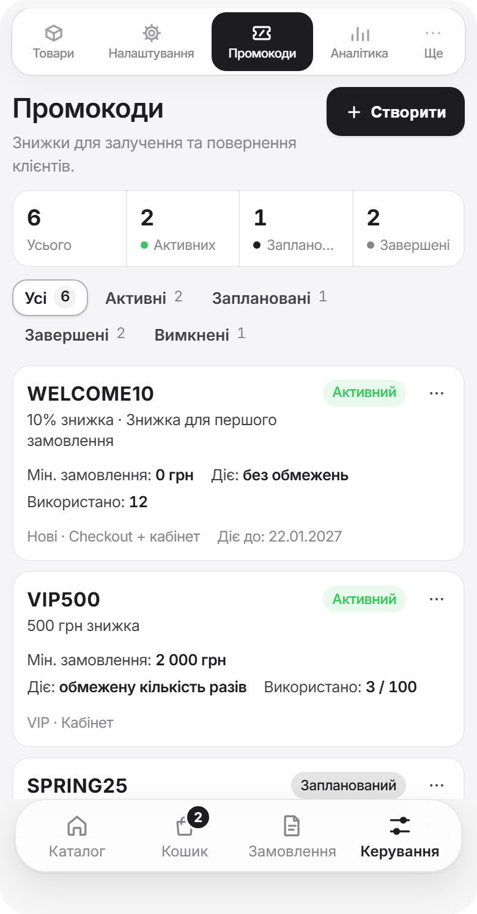{ .phone }

### Клієнти

Вкладка `Клієнти`: база клієнтів (пошук за ім'ям, телефоном, @username або ID, сортування за активністю, виторгом чи кількістю замовлень) і вкладка `Сегменти` — `Нові`, `Повторні`, `VIP`, `Ризик відтоку`. У картці клієнта є кнопки `Написати` (повідомлення від бота вашого магазину), `Копіювати ID` і `Кампанія`. Правила сегментів (`Редагувати правила`) доступні на тарифі Business.

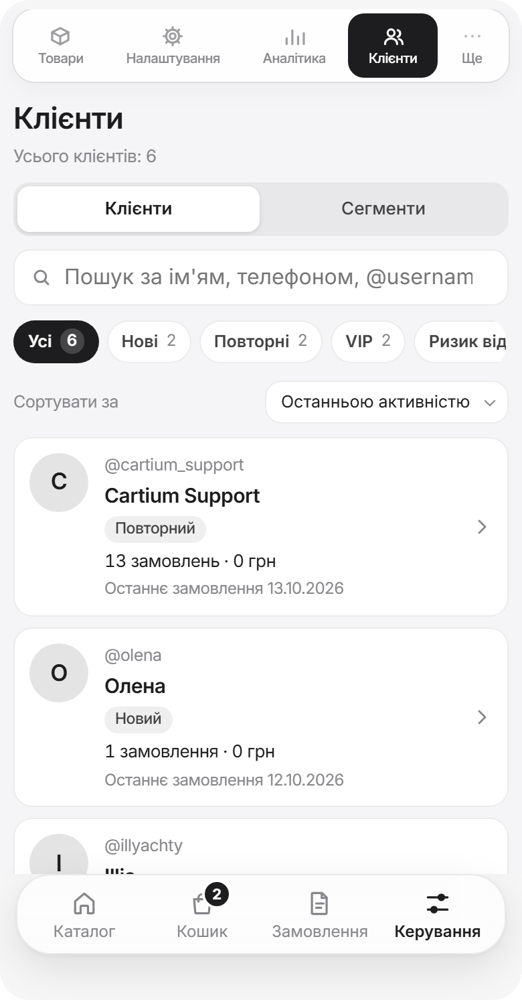{ .phone }

### Кампанії

`Ще` → `Кампанії` — розсилки по сегментах. `Створити` → оберіть `Кому`, напишіть `Текст повідомлення` і натисніть `Надіслати кампанію`. Повідомлення надсилається **одразу** всім клієнтам сегмента, тож перечитайте текст двічі. Історія розсилок із показниками (одержувачів, доставлено, помилок) — на цій же вкладці. У боті розділ `📣 Кампанії` з'являється тільки тоді, коли модуль доступний за тарифом і увімкнений.

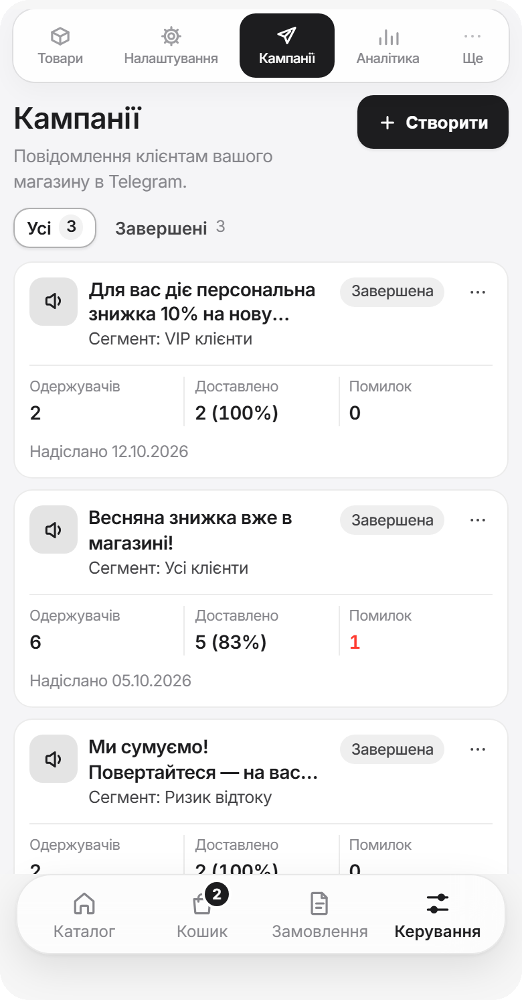{ .phone }

### Аналітика

У боті — `📊 Статистика —✨Pro` з експортом у `📄 CSV` та `📊 Excel (.xlsx)`.

У WebApp — вкладка `Аналітика`: період (`Сьогодні`, `7 днів`, `30 днів`, `90 днів`, `Весь час` або `Свій період…`), показники `Виторг`, `Замовлення`, `Середній чек`, `Конверсія`, `Клієнти`, `Оплати` та графік динаміки продажів.

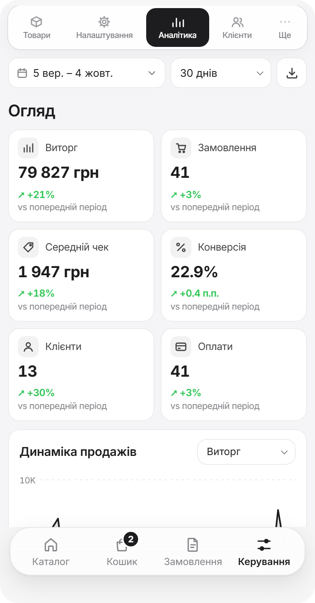{ .phone }

### Крос-продажі

`Ще` → `Крос-продажі` (тариф Business) — рекомендації супутніх товарів на основі оплачених замовлень: що купують разом і які позиції варто пропонувати в кошику. Стає корисною після того, як накопичиться достатньо замовлень: без даних рекомендувати нема з чого.

---

## Чекліст перед запуском

- [ ] Доступ через `/admin` працює
- [ ] Категорії створені
- [ ] Товари активні й мають фото
- [ ] Ціни і варіанти перевірені
- [ ] Є хоча б один робочий спосіб оплати
- [ ] Для товарів `Без ліміту залишку` увімкнена хоча б одна онлайн-оплата
- [ ] Якщо потрібна Нова пошта — API ключ і дані відправника збережені
- [ ] Вигляд і тексти перевірені
- [ ] Тестове замовлення пройдене до кінця
- [ ] Обрано тариф, пробний період не добігає кінця

[Розгорнутий чекліст запуску :material-arrow-right:](launch.md){ .btn-link }

---

## Часті ситуації

??? question "Немає доступу до адмінки"
    Повідомлення «Немає доступу» означає, що вашого Telegram ID немає в списку адміністраторів магазину.

    1. Переконайтеся, що ви під правильним Telegram-акаунтом.
    2. Надішліть боту `/myid`.
    3. Скопіюйте **числовий** ID — не `@username`, а саме число.
    4. Передайте його власнику магазину або платформному адміну.
    5. Він додасть вас у `Налаштування` → `Команда` → **Адміни магазину**.

??? question "Замовлення не рухаються далі"
    Перевірте по черзі:

    - чи клієнт справді оплатив;
    - чи не зависло замовлення в статусі `Оплата на перевірці` — його потрібно підтвердити вручну;
    - чи ви не пропустили фільтри `Очікують` і `На перевірці`.

    Найчастіша причина — замовлення чекає саме на вашу дію.

??? question "Товар не купується"
    Перевірте:

    - чи товар активний (перемикач `Активний`);
    - чи є в нього фото й коректна ціна;
    - чи є в нього варіанти з ненульовим залишком (якщо ввімкнено `Відстежувати залишки`);
    - чи він у правильній категорії;
    - чи не заблокований checkout через відсутність онлайн-оплати для товару в режимі `Без ліміту залишку`.

    Останні два пункти — найпоширеніші приховані причини.

??? question "Не створюється ТТН"
    Для створення ТТН одночасно мають виконуватися п'ять умов:

    1. модуль Нової пошти увімкнений (потрібен тариф Pro або вище);
    2. збережений API ключ і він не прострочений;
    3. заповнені дані відправника — ПІБ і телефон;
    4. вибрані місто і точка відправлення **зі списків пошуку**;
    5. у самому замовленні є дані отримувача з коректним містом і відділенням.

    Найчастіше проблема в пунктах 2, 4 і 5. Докладніше — [Нова пошта](nova-poshta.md).

??? question "Зникла вкладка або модуль"
    Дві причини, в такому порядку перевірки:

    1. модуль вимкнений — подивіться `Налаштування` → `Модулі`;
    2. поточний тариф його не дозволяє — подивіться `Налаштування` → `Підписка`.

??? question "Клієнти пишуть, що магазин не відкривається"
    Спершу перевірте `Налаштування` → `Підписка` → режим доступу. Якщо стоїть `Магазин приховано для клієнтів` або `Пауза checkout` — справа в цьому. Також перевірте, чи не закінчилась підписка.

    Якщо режим звичайний, а магазин усе одно не відкривається — це вже питання до платформного адміністратора.

??? question "Імпорт не додав товари або пропустив рядки"
    Натисніть `Перевірити файл` ще раз і прочитайте список під таблицею: там написано, який саме рядок і чому пропущено. Найчастіше — порожня назва, нульова ціна, назва, що вже є в каталозі. Докладніше — [Імпорт каталогу](import.md).

??? question "Фото з імпорту не з'явилися"
    Фото за посиланнями підтягуються у фоні — це може тривати кілька хвилин. Якщо за годину їх немає, перевірте, що посилання **пряме** (відкриваєте його в браузері — бачите лише картинку). Посилання на Google Диск, Dropbox, Instagram чи сторінки оголошень не працюють. Додайте такі фото вручну кнопкою `Додати фото` в товарі.

---

## Що робити далі

Коли базовий магазин працює стабільно:

1. **Вирівняйте основу.** Каталог, оплати, доставка — щоб не було винятків і ручних милиць.
2. **Наведіть порядок у текстах і вигляді.** Це те, за чим вас запам'ятовують.
3. **Тільки після цього вмикайте зростання.** Промокоди, кампанії, аналітику, крос-продажі.
4. **Регулярно перевіряйте підписку і режим доступу**, щоб магазин не зупинився в найгірший момент.

!!! tip "Головне правило"
    Не намагайтеся ввімкнути все одразу. Спочатку зробіть стабільною операційну основу: каталог, оформлення, оплата, замовлення, доставка. Магазин, у якому працює це, продає більше за магазин з десятком увімкнених модулів і зламаним checkout.
