# Інструкція для власника

Усе про щоденну роботу з магазином: товари, замовлення, оплати, вигляд і зростання. Кожен розділ закриває одну задачу, тож читайте той, що потрібен зараз.

!!! tip "Ще не створили магазин?"
    Почніть зі [Швидкого старту](quick-start.md): вісім кроків до першого замовлення. Сюди повертайтеся, коли магазин уже працює.

[:ph-layout: Як влаштований магазин](#як-влаштований-магазин)
[:ph-storefront: Товари](#товари)
[:ph-clipboard-text: Замовлення](#замовлення)
[:ph-credit-card: Оплати](#оплати)
[:ph-truck: Доставка](#доставка)
[:ph-note-pencil: Вигляд](#вигляд-магазину)
[:ph-seal-check: Підписка й налаштування](#налаштування)
[:ph-lightning: Зростання](#зростання)
[:ph-lifebuoy: Якщо щось не працює](#якщо-щось-не-працює)

---

## Як влаштований магазин

Ваш магазин відкривається прямо в Telegram: кнопка `🛍 Магазин` ліворуч від поля введення в чаті з ботом магазину. Покупці бачать там вітрину, а ви ще й панель керування. Окремий сайт чи застосунок не потрібні.

Унизу екрана чотири розділи:

| Розділ | Що там |
|---|---|
| `Каталог` | Вітрина: те саме, що бачить покупець |
| `Кошик` | Щоб перевірити оформлення очима покупця |
| `Замовлення` | Усі замовлення з пошуком і фільтрами |
| `Керування` | Ваша панель: товари, налаштування, клієнти, аналітика |

`Керування` показується тільки адміністраторам магазину, покупці його не бачать.

{ .phone }

### Вкладки розділу «Керування»

| Вкладка | Для чого |
|---|---|
| `Товари` | Каталог, пошук, створення й редагування |
| `Налаштування` | Підписка, оплати, доставка, вигляд, команда, тексти |
| `Аналітика` | Виторг, замовлення, середній чек за період |
| `Клієнти` | База покупців і сегменти |
| `Ще` → `Імпорт` | Завантаження товарів файлом |
| `Ще` → `Промокоди` | Знижки й бонуси |
| `Ще` → `Кампанії` | Розсилки клієнтам |
| `Ще` → `Крос-продажі` | Що купують разом |

На телефоні частина вкладок захована в меню `Ще`. На компʼютері всі видно в один ряд.

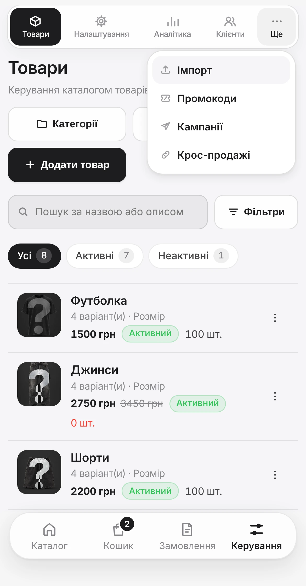{ .phone }

??? question "Я бачу менше вкладок, ніж у списку"
    Вкладка зʼявляється, коли її модуль увімкнений **і** входить у ваш тариф. Перевірте `Налаштування` → `Модулі`: біля кожного модуля написано, чи він доступний.

!!! note "А чат-бот?"
    Бот магазину залишається швидким пультом: сповіщення про нові замовлення приходять туди з кнопкою, яка одразу відкриває замовлення, а кількома командами можна працювати без панелі. Усе про бота зібрано на сторінці [Telegram-бот](bot.md).

---

## Товари

`Керування` → `Товари`

Тут увесь каталог: пошук, фільтри `Усі`, `Активні`, `Неактивні`, ціни, залишки й статуси.

- `Додати товар` відкриває форму нового товару.
- `Категорії` створює категорії й підкатегорії.
- `Імпорт товарів` завантажує багато товарів файлом.
- `⋮` у рядку товару: `Редагувати`, `Дублювати`, `Деактивувати` / `Активувати`.

«Дублювати» економить час, коли треба завести схожий товар: змінюєте лише назву, фото й ціну.

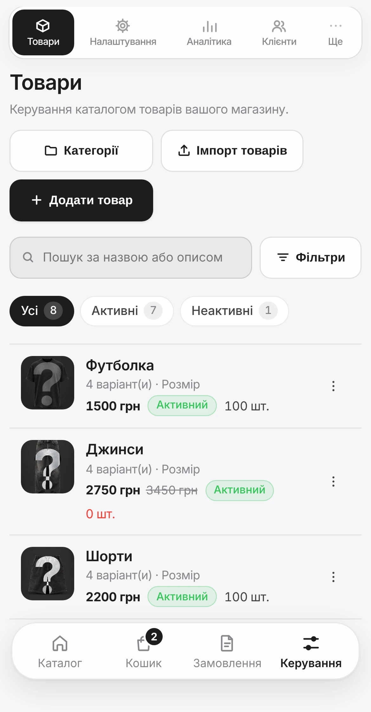{ .phone }

### Категорії

`Керування` → `Товари` → `Категорії`

Створіть категорії **до** товарів. Від них залежить, чи знайде покупець потрібне за два дотики, чи гортатиме довгу стрічку.

1. Введіть `Назва`, наприклад «Одяг».
2. У полі `Де розмістити` залиште `Основна категорія` або оберіть `Підкатегорія в «…»`.
3. Натисніть `Створити категорію`.

Нижче, у списку `Ваші категорії`, видно всі категорії. Кнопка `+ Підкатегорія` біля категорії одразу готує підкатегорію саме в ній. Можливі два рівні: категорія і підкатегорія, наприклад «Одяг / Футболки».

Якщо категорії бракує вже під час додавання товару, натисніть `+ Нова` поруч із полем `Основна категорія`: вона створиться й одразу обереться для товару.

Під час імпорту категорії з файлу створюються автоматично. Змінити порядок, у якому категорії бачать покупці, поки можна в боті: `/admin` → `📂 Категорії`, кнопки `⬆️ Підняти` і `⬇️ Опустити`.

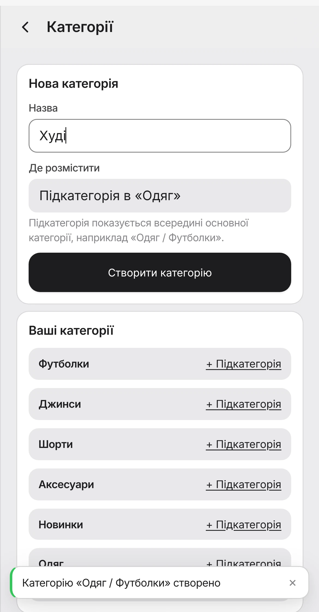{ .phone }

### Форма товару

| Поле | Підказка |
|---|---|
| `Активний` | Вимкніть, щоб тимчасово прибрати товар з вітрини |
| `Назва товару` | Те, що покупець бачить першим. Коротко і зрозуміло |
| `Опис` | Матеріал, посадка, догляд. Розміри й кольори сюди не пишіть |
| `Ціна, грн` | Скільки платить покупець |
| `Ціна зі знижкою` | Відкриває поле `Звичайна ціна, грн`: стара ціна показується закресленою, відсоток рахується сам |
| `Основна категорія` | Обовʼязково, інакше товар важко знайти |
| `Додаткові категорії` | Той самий товар ще й у «Новинках» чи «Знижках», без копій |
| `Фото товару` | До 10 фото, кнопка `Додати фото` |

Внизу кнопка `Зберегти товар`.

{ .phone }

### Фото

- **Перше фото головне.** Саме його видно в каталозі. Щоб зробити головним інше, натисніть на ньому `☆`.
- Інші фото показують деталі, колір, фактуру й масштаб.
- Додавати можна з галереї телефона чи з компʼютера, кілька одразу.

**AI-асистент фото.** Кнопка `AI-асистент фото` під фото вміє замінити фон, зробити студійний кадр, показати товар на людині чи в лайфстайл-сцені. Ви обираєте дію, асистент готує варіант, а ви вирішуєте, чи додати його до товару. Готові варіанти 30 днів зберігаються в `AI-чернетки`. Кожна генерація витрачає AI-кредити: на місяць їх 20, 100 або 300 залежно від [тарифу](#підписка).

### Варіанти і залишки

Якщо товар має розміри, кольори чи обʼєми, заведіть їх **варіантами**: `Назва опції` (наприклад, «Розмір»), потім кнопка `Додати варіант` для кожного значення. Покупець обере потрібне кнопкою, а ви бачитимете залишок по кожному варіанту.

Є два режими обліку:

| Режим | Коли обирати |
|---|---|
| `Відстежувати залишки` | Товар є в наявності. Ви вказуєте кількість, система списує її з кожним замовленням |
| `Без ліміту залишку` | Товар під замовлення або залишки не важливі |

Перемикач `Показувати, коли немає в наявності` вирішує, чи зникне товар з вітрини, коли закінчиться.

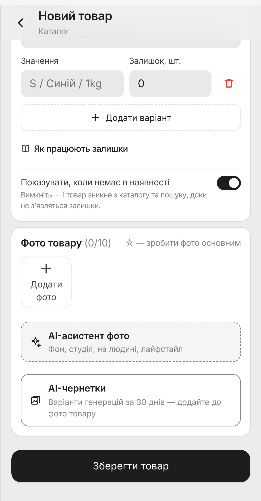{ .phone }

!!! warning "Два правила, через які товар буває неможливо купити"
    - **Облік увімкнений, а варіантів немає.** Залишки рахуються по варіантах, тож покупцю нічого обрати. Додайте хоча б один варіант із кількістю або оберіть `Без ліміту залишку`.
    - **Товар без ліміту залишку і лише післяплата.** Для таких товарів потрібна хоча б одна онлайн-оплата: `LiqPay`, `plata by mono`, `Оплата за посиланням` або `Оплата за реквізитами`. Інакше оформлення заблокується.

### Імпорт каталогу

Десятки чи сотні товарів зручніше завантажити файлом CSV або XLSX: `Керування` → `Ще` → `Імпорт`. Система спочатку перевіряє файл і показує, що буде додано, а створює товари лише після вашого підтвердження. Будь-який імпорт можна скасувати протягом 7 днів.

[Як підготувати файл :ph-arrow-right:](import.md){ .btn-link }

---

## Замовлення

Нижня панель → `Замовлення`

{ .phone }
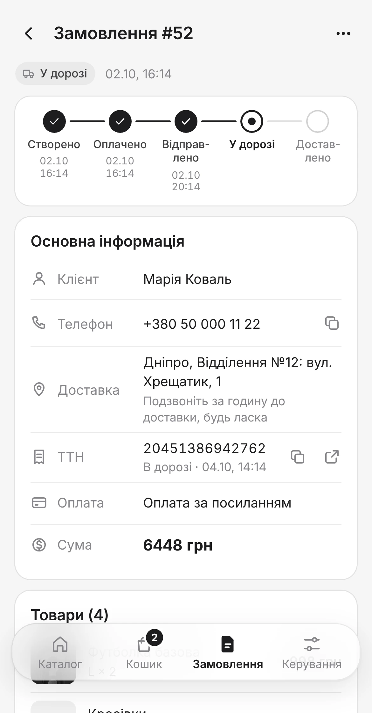{ .phone }

### Фільтри

Над списком плитки з лічильниками. Двічі на день переглядайте `Очікують` і `На перевірці`: там замовлення, яким потрібна ваша дія.

| Фільтр | Що там |
|---|---|
| `Усі` | Повний список |
| `Очікують` | Оплата ще не підтверджена |
| `На перевірці` | Покупець натиснув «Я оплатив(ла)», перевірте надходження |
| `До відправки` | Оплачені або з післяплатою, можна відправляти |
| `У дорозі` | Уже відправлені |
| `Завершені` | Закриті |

Шукати можна за номером, імʼям або телефоном покупця. Поруч сортування: `Спочатку нові`, `Спочатку старі`, `№ за спаданням`, `№ за зростанням`.

### Статуси

=== "Онлайн-оплата"

    | Статус | Що означає | Що робити |
    |---|---|---|
    | `⏳ Очікує оплати` | Замовлення створене, оплати ще немає | Зачекати |
    | `🧾 Оплата на перевірці` | Покупець натиснув `Я оплатив(ла)` | Перевірити надходження й підтвердити |
    | `✅ Оплачено` | Оплата підтверджена | Відправити |
    | `❌ Скасовано` | Замовлення скасоване | — |
    | `⌛ Прострочено` | Оплату не завершили вчасно | — |

    Для LiqPay і plata by mono статус `Оплачено` ставиться сам, щойно банк підтвердить платіж.

=== "Післяплата"

    | Статус | Що означає | Що робити |
    |---|---|---|
    | `📦 Очікує відправки` | Замовлення готове до відправлення | Створити ТТН і відправити |
    | `🚚 Відправлено` | Посилка в дорозі | Чекати |
    | `📍 Очікує отримання` | Посилка у відділенні | Чекати |
    | `✅ Оплачено` | Покупець забрав і оплатив | Нічого, замовлення завершене |
    | `❌ Скасовано` | Не забрали або повернули | — |

### Дії в картці замовлення

Унизу картки велика кнопка з дією, яка найімовірніше потрібна зараз. Поруч менші дії, решта в меню `…`. Значок `ⓘ` пояснює, що станеться: кому прийде повідомлення, чи спишуться залишки.

| Дія | Коли зʼявляється |
|---|---|
| `Підтвердити оплату` | Оплату треба перевірити вручну |
| `Створити ТТН` | Нова пошта налаштована, є дані отримувача |
| `Відстежити`, `Скопіювати ТТН`, `Оновити статус ТТН` | ТТН уже створена |
| `Перевипустити ТТН`, `Скасувати ТТН` | Накладну треба виправити |
| `Позначити відправленим`, `Позначити у відділенні`, `Оплачено / отримано` | Етапи післяплати |
| `Скасувати / повернення` | Замовлення треба скасувати |

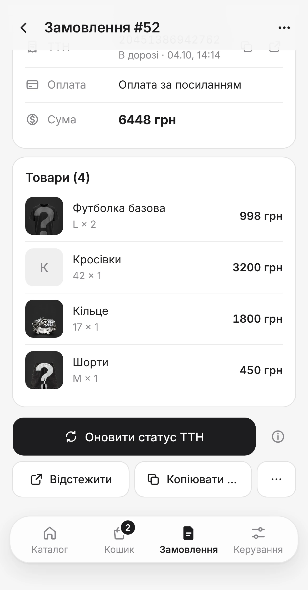{ .phone }

!!! tip "Найважливіша звичка на старті"
    Замовлення `На перевірці` означає, що людина вже заплатила й чекає на вашу відповідь. Підтверджуйте такі оплати того ж дня: саме з цього починається довіра покупців.

---

## Оплати

`Керування` → `Налаштування` → `Оплати`

| Спосіб | Як працює | Підтвердження |
|---|---|---|
| `LiqPay` | Картка, Apple Pay, Google Pay | Автоматично |
| `plata by mono` | Картка будь-якого банку, Apple Pay, Google Pay | Автоматично |
| `Оплата за посиланням` | Ваша банка або платіжна сторінка | Вручну |
| `Оплата за реквізитами` | Переказ за IBAN | Вручну |
| `Післяплата` | Оплата при отриманні | — |

Кожен спосіб має перемикач і статус. Покупцям показуються лише способи зі статусом `Активний`. Після змін натисніть `Зберегти зміни`.

{ .phone }

[Покрокове підключення кожного способу :ph-arrow-right:](payments.md){ .btn-link }

---

## Доставка

`Керування` → `Налаштування` → `Доставка`

Нова пошта підключається за пʼять хвилин і доступна з тарифу **Pro**. Потрібні API ключ із бізнес-кабінету Нової пошти, місто й відділення відправлення (обовʼязково **вибрані зі списку**, а не введені вручну) і ваші ПІБ та телефон. Після цього ТТН створюється з картки замовлення однією кнопкою.

[Детальний гайд по Новій пошті :ph-arrow-right:](nova-poshta.md){ .btn-link }

---

## Вигляд магазину

`Керування` → `Налаштування` → `Вигляд`

Налаштування згруповані в розділи, відкривайте по одному. Кнопка `Попередній перегляд` угорі покаже результат, `Зберегти зміни` внизу застосує його.

| Розділ | Що змінюється |
|---|---|
| `Шаблон магазину` | Структура головної: банери, порядок секцій, сітка товарів |
| `Верхній рядок` | Біжучий рядок з оголошенням, наприклад про безкоштовну доставку |
| `Банер у шапці` | Назва, текст або картинка близько 1200×240 px |
| `Категорії` | Стиль і кольори кнопок категорій |
| `Фон каталогу` | Колір або вертикальна картинка 1080×1920 px |
| `Типографіка` | Шрифт і колір тексту |
| `Кнопки та елементи` | Світла чи темна тема, колір кнопок, скруглення, тіні |

{ .phone }

Зміни одразу видно у вітрині, перезапускати нічого не треба. Кількість шаблонів залежить від тарифу: 1, 3 або 10.

!!! tip "Що справді важливо"
    Якісні фото товарів і зрозумілий логотип дають більше, ніж будь-які шрифти й тіні. Почніть із них.

---

## Налаштування

`Керування` → `Налаштування`

Угорі ряд розділів, він гортається вбік: `Усі`, `Підписка`, `Оплати`, `Покупці`, `Модулі`, `Доставка`, `Вигляд`, `Команда`, `Контент`.

### Підписка

| | Basic | Pro | Business |
|---|---|---|---|
| На місяць | $10 | $20 | $40 |
| На рік | $96 | $192 | $384 |
| Шаблонів магазину | 1 | 3 | 10 |
| AI-кредитів на місяць | 20 | 100 | 300 |
| Нова пошта, імпорт, промокоди, кампанії, нагадування про кошик, кабінет покупця, клієнти, аналітика | — | ✔ | ✔ |
| Власні правила сегментів, крос-продажі | — | — | ✔ |

Нові магазини отримують **14 днів** безкоштовно. Річна оплата на 20% дешевша. Оплатити можна кнопкою `Оплатити підписку`; перед першою оплатою потрібно підтвердити умови. Історія платежів і договори нижче на сторінці.

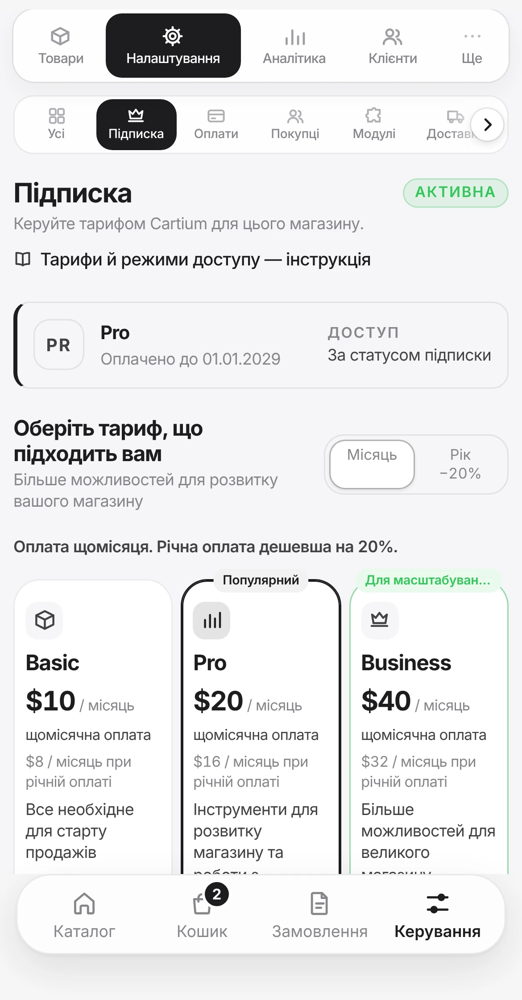{ .phone }

**Режим доступу магазину** обирається внизу картки й застосовується кнопкою `Застосувати режим`:

| Режим | Що відбувається |
|---|---|
| `За статусом підписки` | Звичайний режим: магазин працює, поки активна підписка |
| `Працює у звичайному режимі` | Магазин працює незалежно від статусу підписки |
| `Пауза checkout` | Каталог видно, але нові замовлення не приймаються |
| `Магазин приховано для клієнтів` | Вітрина тимчасово недоступна |

!!! tip "Їдете у відпустку?"
    Поставте `Пауза checkout` замість того, щоб ховати магазин. Покупці бачитимуть асортимент і повернуться, коли ви знімете паузу.

### Покупці

- **Нагадування про кошик.** Автоматичне повідомлення тим, хто додав товари в кошик, але не оформив замовлення. Ви пишете текст і обираєте, коли надіслати: через 30 хвилин, 6 або 24 години.
- **Кабінет покупця.** Вхід за e-mail або через Telegram, історія замовлень і бонуси.

### Модулі

Тут вмикаються додаткові можливості: аналітика, промокоди, кампанії, Нова пошта та інші. Біля кожного модуля написано, чи він `Входить у тариф`, чи `Потрібен Pro` / `Потрібен Business`.

Якщо якоїсь вкладки не видно, почніть пошук причини звідси.

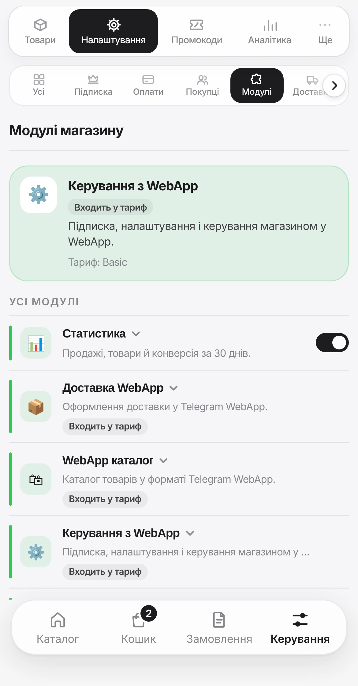{ .phone }

### Команда

Щоб додати ще одного адміністратора, введіть його **числовий Telegram ID** і натисніть `Додати`. Дізнатися ID просто: людина надсилає боту магазину команду `/myid`.

### Контент

- **Тексти магазину:** привітання, описи, службові повідомлення.
- **Кнопки та назви:** підписи кнопок і розділів, які бачать покупці.

---

## Зростання

Ці інструменти допомагають продавати більше, коли основа вже працює: товари, оплата, доставка. Більшість доступні з тарифу Pro.

### Промокоди

`Керування` → `Ще` → `Промокоди`

`Створити` відкриває форму:

| Поле | Що задає |
|---|---|
| `Код` | Латиниця, цифри, `_` і `-` |
| `Тип знижки`, `Значення` | `Відсоток` або `Фіксована сума` |
| `Мін. сума замовлення` | Необовʼязково |
| `Скільки разів діє` | `Без обмежень`, `Одноразовий`, `Обмежена кількість`, `Один раз на клієнта` |
| `Для кого` | `Для всіх`, `Нові клієнти`, `Повторні клієнти`, `VIP`, `Повернення сплячих` |
| `Де показувати` | `Лише checkout`, `Лише кабінет` або `Checkout і кабінет` |

Промокод із показом у кабінеті стає бонусом для обраної групи клієнтів.

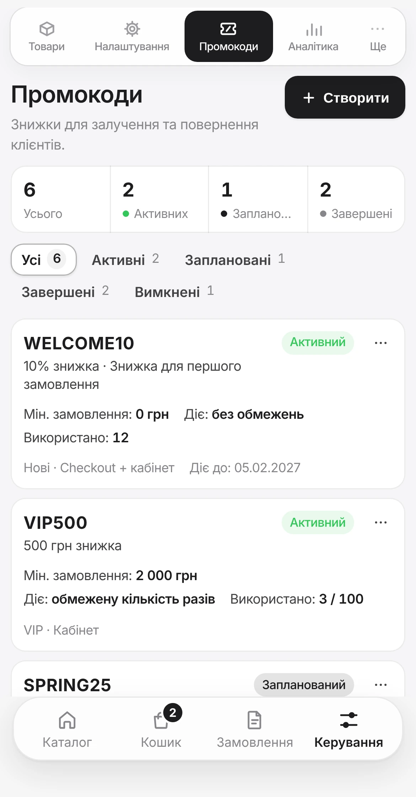{ .phone }

### Клієнти

Вкладка `Клієнти`: усі покупці з пошуком за імʼям, телефоном, @username чи ID і сортуванням за активністю, виторгом або кількістю замовлень.

Вкладка `Сегменти` ділить їх на групи: `Нові`, `Повторні`, `VIP`, `Ризик відтоку`. У картці клієнта є кнопки `Написати`, `Копіювати ID` і `Кампанія`. Власні правила сегментів доступні на тарифі Business.

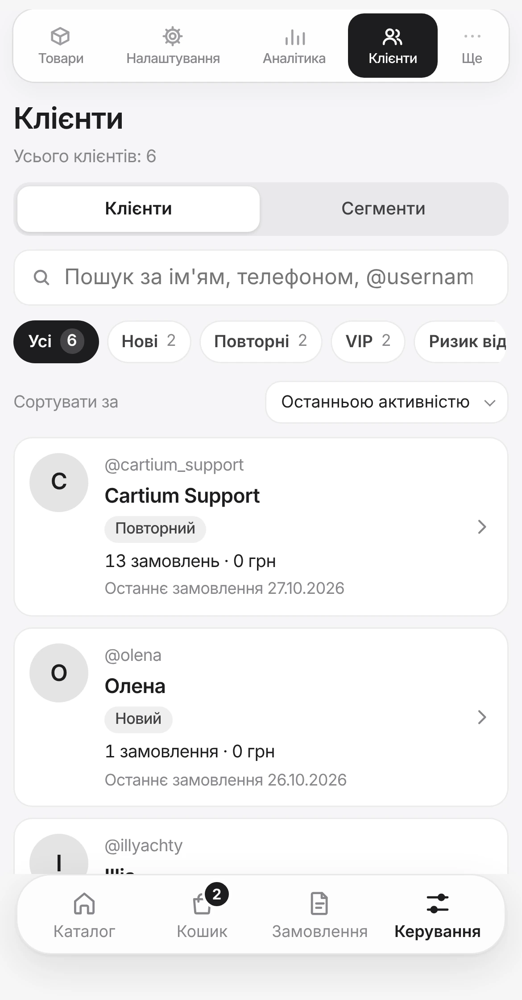{ .phone }

### Кампанії

`Ще` → `Кампанії` → `Створити`: оберіть, `Кому` надіслати, напишіть `Текст повідомлення` і натисніть `Надіслати кампанію`.

Повідомлення йде **одразу** всім клієнтам сегмента, тож перечитайте текст двічі. Нижче історія розсилок: скільки отримали, скільки доставлено, скільки помилок.

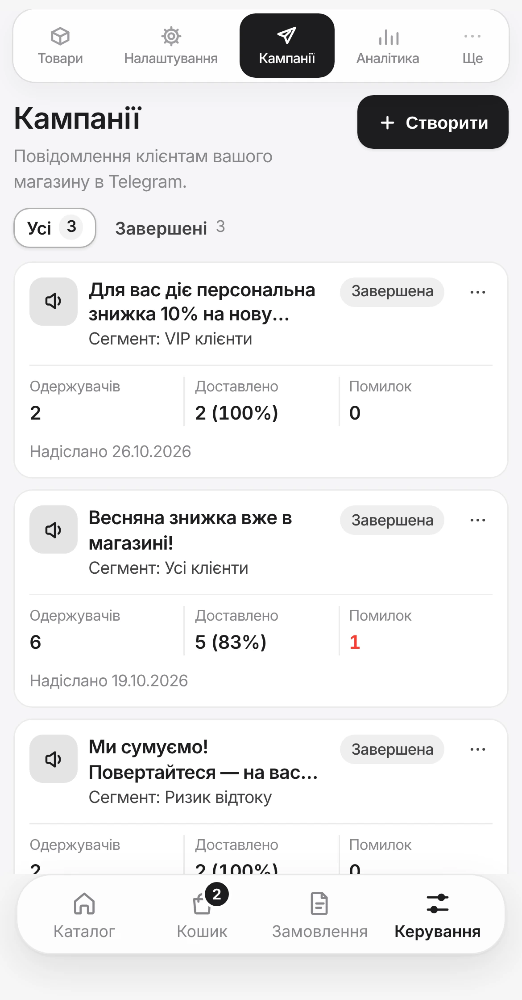{ .phone }

### Аналітика

Вкладка `Аналітика`: оберіть період (`Сьогодні`, `7 днів`, `30 днів`, `90 днів`, `Весь час` або `Свій період…`) і дивіться виторг, кількість замовлень, середній чек, конверсію, клієнтів, оплати та графік продажів.

Раз на тиждень переглядайте `7 днів`: так ви помітите, що продається, а що ні.

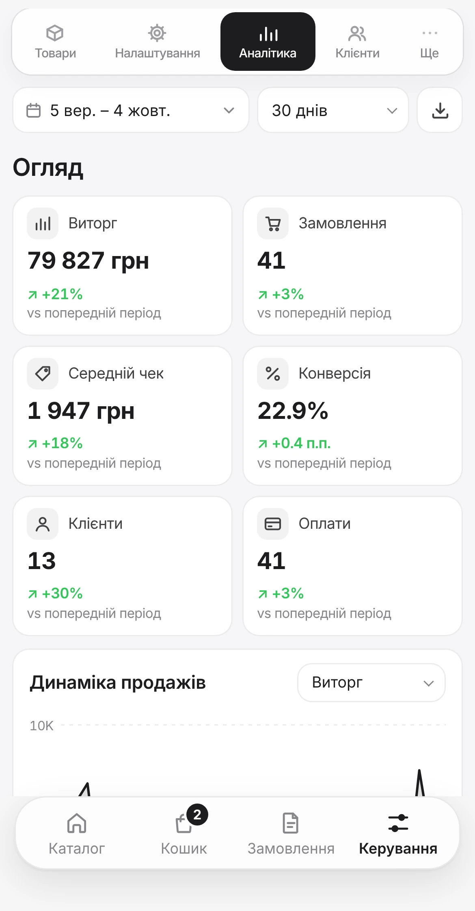{ .phone }

### Крос-продажі

`Ще` → `Крос-продажі` (тариф Business) показує, які товари купують разом, і підказує, що запропонувати в кошику. Корисно, коли вже накопичилося достатньо замовлень.

---

## Якщо щось не працює

??? question "Не бачу розділу «Керування»"
    Його бачать лише адміністратори магазину. Якщо магазин не ваш, попросіть власника додати вас: надішліть боту магазину `/myid`, скопіюйте **число** (не @username) і передайте йому. Він додасть вас у `Налаштування` → `Команда`.

    Якщо ви власник, а розділу немає, напишіть нам у [@cartium_support_bot](https://t.me/cartium_support_bot).

??? question "Покупець не може купити товар"
    Перевірте по черзі:

    1. Товар увімкнений (перемикач `Активний`) і має ціну.
    2. Якщо ввімкнено `Відстежувати залишки`, є варіант із ненульовою кількістю.
    3. Для товару `Без ліміту залишку` увімкнена хоча б одна онлайн-оплата.
    4. У `Налаштування` → `Підписка` не стоїть `Пауза checkout`.

    Пункти 2 і 3 трапляються найчастіше.

??? question "Замовлення не рухається далі"
    Найчастіше воно чекає саме на вас. Відкрийте фільтри `Очікують` і `На перевірці`. Замовлення в статусі `Оплата на перевірці` треба підтвердити вручну кнопкою `Підтвердити оплату`.

??? question "Оплата пройшла, а статус не змінився"
    Для LiqPay і plata by mono статус оновлюється сам протягом хвилини. Якщо ні, перевірте, що ключі в магазині того ж режиму, в якому ви платили: тестові для тестової оплати, бойові для реальної. Детальніше на сторінці [Оплати](payments.md#перевірка-чи-все-працює).

??? question "Не створюється ТТН"
    Найчастіші причини: минув термін дії API ключа, місто чи відділення введені вручну замість вибору зі списку, у замовленні неповні дані отримувача. Як це виправити, читайте на сторінці [Нова пошта](nova-poshta.md#якщо-щось-не-працює).

??? question "Зникла вкладка"
    Перевірте `Налаштування` → `Модулі`: модуль міг бути вимкнений. Якщо він позначений `Потрібен Pro` чи `Потрібен Business`, ваш тариф його не включає.

??? question "Покупці пишуть, що магазин не відкривається"
    Відкрийте `Налаштування` → `Підписка`. Перевірте, що підписка активна, а режим доступу не `Магазин приховано для клієнтів` і не `Пауза checkout`.

??? question "Імпорт пропустив рядки або фото не зʼявилися"
    Під таблицею перевірки написано, який рядок і чому пропущено: найчастіше порожня назва, нульова ціна або товар із такою назвою вже є. Фото за посиланнями підтягуються у фоні кілька хвилин і працюють лише з прямими посиланнями на картинку. Детальніше в [Імпорті каталогу](import.md).

!!! info "Не знайшли відповіді?"
    Напишіть нам у Telegram: [@cartium_support_bot](https://t.me/cartium_support_bot). Опишіть, що робили і що бачите на екрані, а якщо можна, додайте знімок.
