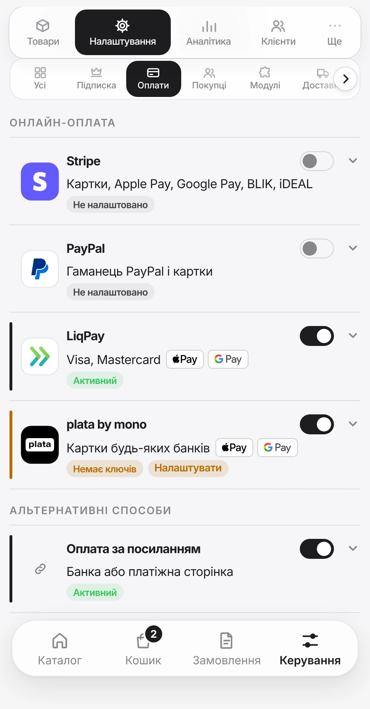
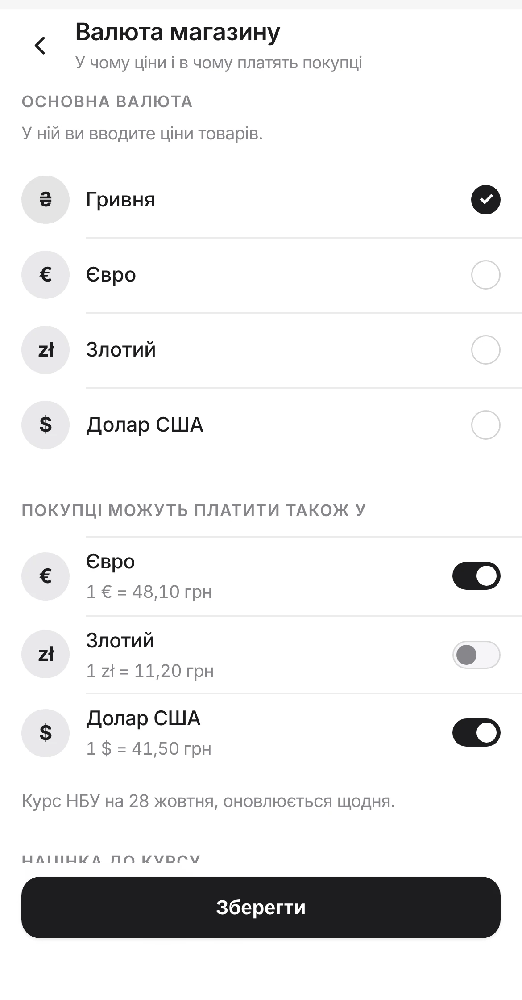
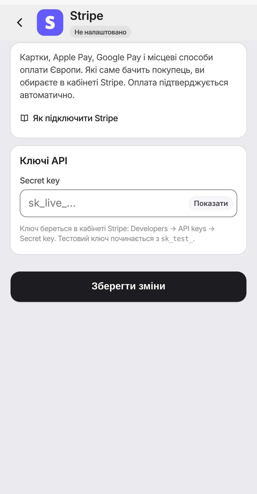
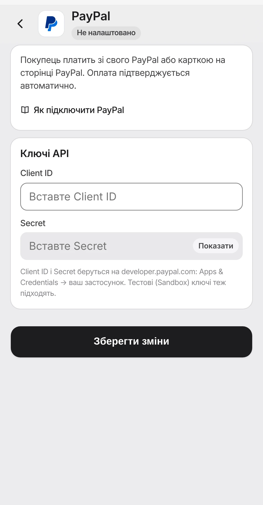
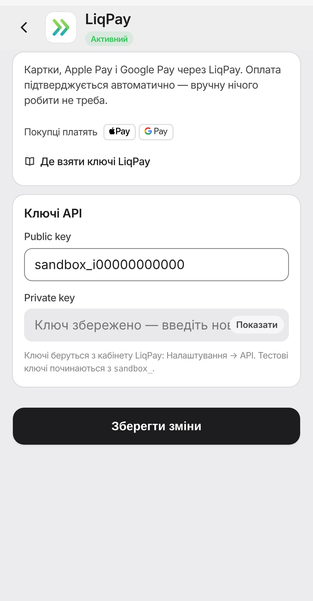
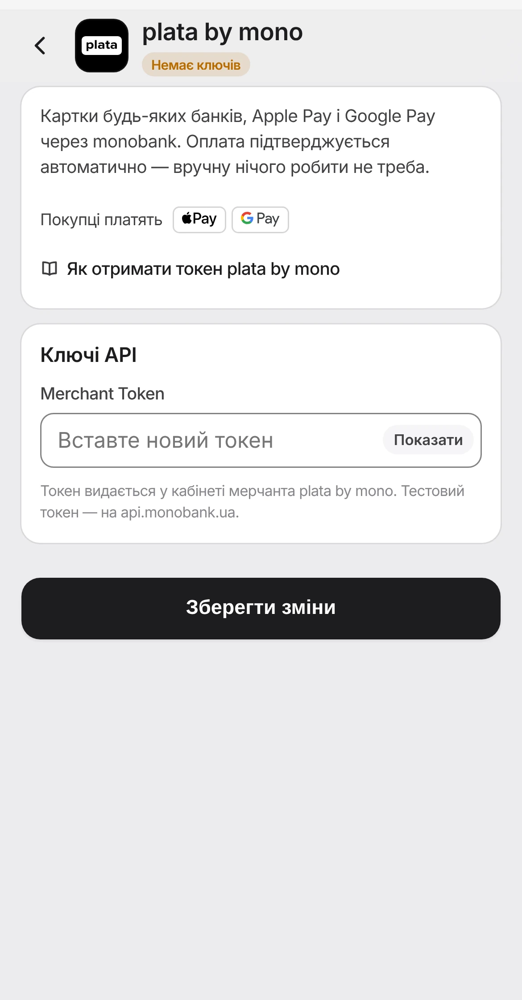
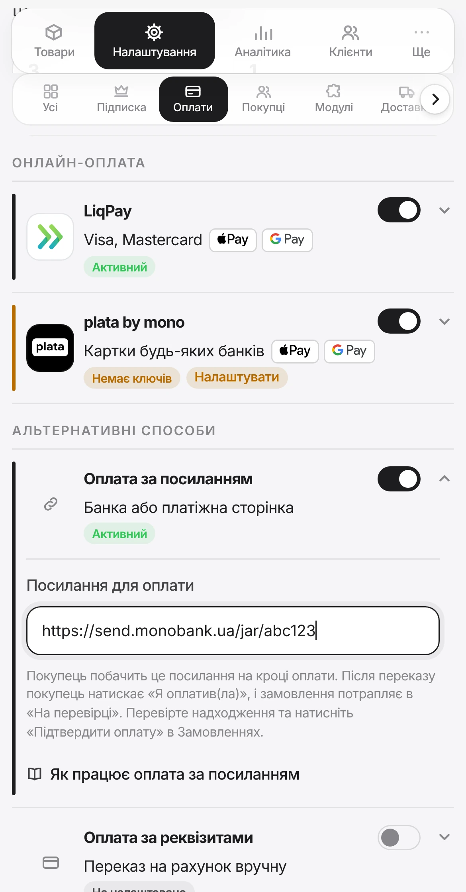
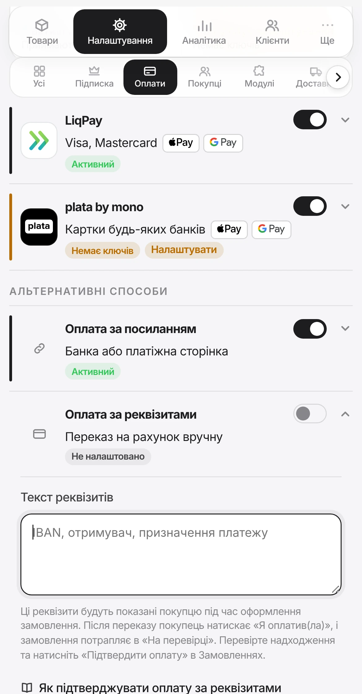

# Оплати

Усе, щоб приймати гроші: які способи є, як підключити кожен і як перевірити, що оплата справді доходить до вас.

!!! tip "Подайте заявку в банк першою"
    Онлайн-оплату LiqPay чи plata by mono банк підтверджує кілька днів: він перевіряє дані про бізнес. Подайте заявку одразу, а каталог і доставку налаштовуйте паралельно. Так ви не втратите тиждень на очікуванні.

Інструкції банків звірено з їхніми публічними сторінками — жовтень 2026

!!! note "Інтерфейс банків змінюється"
    Назви пунктів у кабінетах LiqPay і Monobank банки можуть міняти. Якщо щось називається інакше — шукайте пункт із тим самим змістом (ключі API, токен, оплата на сайті) або запитайте в чаті підтримки банку.

---

## Які способи є

| Спосіб | Як працює | Підтвердження |
|---|---|---|
| { .pay-logo width="24" height="24" } **Stripe** | Онлайн-оплата для Європи: картка, Apple Pay, Google Pay, BLIK, iDEAL та інші | Автоматичне |
| { .pay-logo width="24" height="24" } **PayPal** | Гаманець PayPal або картка на сторінці PayPal | Автоматичне |
| { .pay-logo width="24" height="24" } **LiqPay** | Онлайн-еквайринг: картка, Apple Pay, Google Pay | Автоматичне |
| { .pay-logo width="24" height="24" } **plata by mono** | Онлайн-еквайринг Monobank: картка будь-якого банку, Apple Pay, Google Pay | Автоматичне |
| { .pay-logo width="24" height="24" } **Оплата за посиланням** | Покупець переходить за вашим платіжним посиланням (банка або платіжна сторінка) | Ручне |
| { .pay-logo width="24" height="24" } **Оплата за реквізитами** | Переказ на рахунок за IBAN | Ручне |
| { .pay-logo width="24" height="24" } **Післяплата** | Оплата при отриманні посилки | — |

Усе налаштовується в одному місці:

`Керування` → `Налаштування` → `Оплати`

Кожен спосіб має **перемикач** і **статус**:

- `Активний`: увімкнено й налаштовано, покупці бачать цей спосіб;
- `Немає ключів` і кнопка `Налаштувати`: спосіб увімкнено, але без ключів покупцям він не показується;
- `Не налаштовано`: вимкнено й порожньо.

Натисніть на рядок, щоб відкрити налаштування способу: ключі, посилання чи текст реквізитів. Після змін зʼявиться панель **«Є незбережені зміни»**, натисніть `Зберегти зміни`.

{ .phone }

!!! info "Скільки способів вмикати"
    Для запуску достатньо одного. Але звʼязка «онлайн-оплата + післяплата» підходить майже всім: хто готовий, платить одразу, а хто сумнівається, замовляє з оплатою при отриманні.

---

## Валюти магазину

Нагорі екрана `Оплати` є рядок `Валюта магазину`. Торкніться його, відкриється окремий екран:

- `Основна валюта`: `Гривня (грн)`, `Євро (€)`, `Злотий (zł)` або `Долар США ($)`. У ній ви вводите ціни товарів.
- `Покупці можуть платити в`: позначте від однієї до чотирьох валют. Основна позначена завжди.

Натисніть `Зберегти`. У рядку `Валюта магазину` видно основну валюту й інші, у яких платять покупці.

Якщо позначено кілька валют, у вітрині поруч із пошуком з'являється кнопка валюти зі знаком `₴`, `€`, `$` або `zł`. Покупець обирає валюту, і ціни в каталозі й кошику показуються в ній. Вибір запам'ятовується.

{ .phone }

### Як рахуються ціни в інших валютах

- За офіційним курсом НБУ. Курс оновлюється щодня, поточний видно в блоці `Курс` на екрані валюти.
- `Націнка до курсу НБУ, %` додається зверху: від 0 до 20 %. Вона покриває різницю курсів і комісію за конвертацію.
- Ціна округлюється до цілого: 1 200 грн за курсом 48,10 з націнкою 2 % стане 25 €.
- Хочете круглу ціну, наприклад 25 € замість 26 €? Задайте її в картці товару в полі `Ціна, €`. Ваша ціна завжди важливіша за курс. Порожнє поле означає «за курсом», а підказка в ньому показує, скільки вийде.
- Якщо курс НБУ кілька днів не оновлюється, інші валюти тимчасово зникають з вітрини. Ціни в основній валюті працюють як завжди.

### Сума не зміниться під час оплати

Ціна фіксується в замовленні в момент оформлення: сума, валюта й курс. Покупець платить рівно ту суму, яку бачив, навіть якщо курс змінився за цей час.

Якщо магазин приймає кілька валют, на екрані оплати покупець сам обирає валюту зі списку `Валюта оплати`. Наперед нічого не обрано, і способи оплати з'являються лише після вибору. Так покупець точно знає, скільки й у чому платить. Ціни при цьому беруться з того самого замовлення, без нового курсу.

- Сторінка `Stripe` чи `PayPal`, відкрита в старій валюті, закривається. Оплатити стару суму вже не вийде.
- Якщо покупець уже відкрив оплату в гривнях через `LiqPay` чи `plata by mono`, валюту цього замовлення можна змінити лише через добу. Так гривнева сторінка не залишиться відкритою поруч з іншою валютою.

### Які способи оплати в якій валюті

| Спосіб | Валюта |
|---|---|
| `Stripe`, `PayPal` | валюта, яку обрав покупець |
| `LiqPay`, `plata by mono`, `Оплата за посиланням` | гривня |
| `Накладений платіж` | гривня, якщо ви її приймаєте |
| `Оплата за реквізитами` | валюта замовлення |

Гривневі способи покупець бачить і в інших валютах. Під ними написано `Оплата в гривнях:` і сума. Якщо покупець обере такий спосіб, замовлення перейде в гривню, а банк покупця сам сконвертує списання з його картки.

!!! warning "Гривневі способи працюють, поки ви приймаєте гривню"
    Якщо зняти гривню з `Покупці можуть платити в`, `LiqPay`, `plata by mono` і `Оплата за посиланням` позначаються `Лише для гривні` і покупцям не показуються. Тоді підключіть `Stripe` або `PayPal`.

- Ціни при зміні **основної** валюти не перераховуються. Було 500 грн, стане 500 €. Після такої зміни перевірте ціни товарів.
- Звіти й аналітика рахують виторг в основній валюті, хоч би в якій валюті платив покупець.
- Ціни вводяться цілими числами, без центів.

---

## { .pay-logo width="28" height="28" } Stripe { #stripe }

Stripe приймає оплату в євро, злотих і доларах. Покупець бачить картки, Apple Pay і Google Pay, а також місцеві способи: BLIK у Польщі, iDEAL у Нідерландах, Bancontact у Бельгії. Які саме способи показувати, ви обираєте в кабінеті Stripe.

Вам знадобиться один ключ: `Secret key`.

### Крок 1. Створіть акаунт Stripe

Зареєструйтеся на stripe.com і заповніть дані про бізнес. Поки Stripe їх перевіряє, можна працювати з тестовим ключем.

### Крок 2. Скопіюйте ключ

У кабінеті Stripe відкрийте **Developers → API keys** і скопіюйте **Secret key**. Тестовий ключ починається з `sk_test_`, бойовий з `sk_live_`.

!!! warning "Потрібен саме Secret key"
    Ключ `pk_…` (Publishable key) не підходить. Магазин підкаже, якщо ви вставили не той.

### Крок 3. Підключіть у магазині

`Керування` → `Налаштування` → `Оплати` → `Stripe`

1. Вставте ключ у поле `Secret key`.
2. Увімкніть перемикач і натисніть `Зберегти зміни`.

Магазин одразу перевіряє ключ у Stripe. Якщо Stripe його не прийняв, ключ не збережеться.

{ .phone }

### Крок 4. Перевірте оплату

З тестовим ключем оплатіть замовлення тестовою карткою `4242 4242 4242 4242` (будь-яка дата в майбутньому, будь-який CVC). Після оплати покупець повертається в Telegram, а замовлення стає `Оплачено` само.

Коли Stripe активує акаунт, замініть тестовий ключ на бойовий `sk_live_…`.

---

## { .pay-logo width="28" height="28" } PayPal { #paypal }

PayPal зручний покупцям, які не хочуть вводити картку: вони входять у свій PayPal і підтверджують оплату. Без акаунта PayPal теж можна оплатити карткою.

Вам знадобляться `Client ID` і `Secret`.

### Крок 1. Потрібен бізнес-акаунт

Звичайний особистий акаунт не приймає оплату від магазинів. Створіть бізнес-акаунт на paypal.com або переведіть у нього наявний.

### Крок 2. Створіть застосунок і скопіюйте ключі

1. Увійдіть на developer.paypal.com тим самим акаунтом.
2. Відкрийте **Apps & Credentials** і створіть застосунок (Create App).
3. Скопіюйте **Client ID** і **Secret**.

Нагорі сторінки є перемикач **Sandbox / Live**. Ключі Sandbox тестові, Live бойові.

### Крок 3. Підключіть у магазині

`Керування` → `Налаштування` → `Оплати` → `PayPal`

1. Вставте `Client ID` і `Secret`.
2. Увімкніть перемикач і натисніть `Зберегти зміни`.

Магазин сам визначить, тестові це ключі чи бойові, і перевірить їх у PayPal.

{ .phone }

### Крок 4. Перевірте оплату

З ключами Sandbox оплатіть замовлення тестовим покупцем: його логін і пароль є на developer.paypal.com у розділі **Sandbox accounts**. Після оплати замовлення стає `Оплачено` само. Потім замініть ключі на Live.

---

## { .pay-logo width="28" height="28" } LiqPay { #liqpay }

LiqPay — платіжний сервіс ПриватБанку. Вам знадобляться два ключі з кабінету LiqPay: `Public key` (відкритий) і `Private key` (закритий).

!!! warning "Закритий ключ — як пароль"
    `Private key` дає змогу підписувати платежі від імені вашого магазину. Не надсилайте його в чатах, не робіть із ним знімків екрана й не публікуйте. Магазин зберігає його в зашифрованому вигляді й після збереження більше не показує.

### Крок 1. Створіть компанію в LiqPay

1. Відкрийте [liqpay.ua](https://www.liqpay.ua) і увійдіть: за номером телефону з підтвердженням через SMS або в застосунку Приват24. Якщо облікового запису ще немає, його буде створено.
2. Створіть **компанію** (магазин) — кнопка «Створити магазин». Вкажіть назву й e-mail. Якщо LiqPay запитає адресу сайту, а сайту у вас немає, вкажіть посилання на вашого бота (`https://t.me/імʼя_вашого_бота`) і уточніть у підтримці LiqPay, чи цього достатньо.
3. Заповніть дані про бізнес, які попросить LiqPay.

### Крок 2. Спершу — тестові ключі

Для кожної компанії LiqPay створює **дві пари ключів**: бойову й тестову. Тестові ключі починаються з `sandbox_`, працюють без реальних списань і доступні одразу. Це найкращий спосіб перевірити, що все підключено правильно, поки компанію ще не активовано.

1. У кабінеті LiqPay відкрийте `Налаштування` → `API`.
2. Увімкніть **тестовий режим** перемикачем у кабінеті — тоді покажуться тестові ключі `sandbox_…`.
3. Скопіюйте `Public key` і `Private key` (закритий ключ може бути прихований — натисніть значок «око»).

### Крок 3. Підключіть ключі в магазині

1. Відкрийте `Керування` → `Налаштування` → `Оплати`.
2. Увімкніть перемикач `LiqPay` і відкрийте його налаштування.
3. Вставте `Public key`.
4. Вставте `Private key` (кнопка `Показати` дозволяє перевірити, що вставилося без помилок).
5. Натисніть `Зберегти зміни`.

Нічого більше в LiqPay налаштовувати не треба: адресу, на яку банк надсилає підтвердження оплати, магазин передає сам із кожним платежем.

{ .phone }

### Крок 4. Перевірте тестовим платежем

1. Відкрийте магазин як покупець, додайте товар у кошик, оформте замовлення й оберіть `Оплатити онлайн через LiqPay`.
2. На сторінці LiqPay введіть **тестову картку**. Актуальні тестові картки LiqPay публікує на своїй сторінці «Тестування» ([liqpay.ua/doc/api/testing](https://www.liqpay.ua/doc/api/testing)); зазвичай це `4242 4242 4242 4242`, будь-який майбутній термін дії та будь-який CVV.
3. Поверніться в магазин: замовлення має отримати статус `Оплачено` **автоматично**.

Тестові платежі — це лише перевірка: гроші не списуються й на рахунок не надходять.

### Крок 5. Перейдіть на бойові ключі

Щоб приймати реальні гроші, компанію в LiqPay потрібно **активувати**: банк перевіряє дані про бізнес. Терміни залежать від банку — тому подавайте заявку заздалегідь. Після активації:

1. У кабінеті LiqPay вимкніть тестовий режим і скопіюйте **бойові** `Public key` і `Private key` (вони **не** починаються з `sandbox_`).
2. У магазині відкрийте налаштування `LiqPay`, вставте нові ключі замість тестових і натисніть `Зберегти зміни`.
3. Зробіть ще один платіж реальною карткою на мінімальну суму (див. [Перевірка](#перевірка-чи-все-працює)).

!!! danger "Тестові ключі не приймають реальні гроші"
    Якщо магазин працює на ключах `sandbox_…`, покупці бачитимуть успішну оплату, але гроші до вас **не надійдуть**. Перед запуском обов'язково замініть їх на бойові.

---

## { .pay-logo width="28" height="28" } Monobank Merchant { #monobank-merchant }

У налаштуваннях магазину цей спосіб називається `plata by mono` — це інтернет-еквайринг monobank. Вам потрібен один ключ — `Merchant Token`.

### Крок 1. Підключіть еквайринг

Еквайринг monobank доступний бізнесу: ФОП та юридичним особам (ТОВ, благодійним фондам і подібним). Потрібен бізнес-рахунок у monobank.

1. Відкрийте веб-кабінет [web.monobank.ua](https://web.monobank.ua) і увійдіть за номером телефону або QR-кодом із застосунку.
2. Додайте інструмент **«Оплата на сайті»** (інтернет-еквайринг): коротко опишіть бізнес і підпишіть заяву в застосунку monobank.
3. Дочекайтеся підтвердження банку. Якщо потрібне уточнення — напишіть у підтримку monobank із застосунку.

??? example "Готовий текст звернення в підтримку"
    Вітаю. Потрібно підключити інтернет-еквайринг (plata by mono) для нашого магазину.

    Ми продаємо товари онлайн через Telegram-магазин і хочемо приймати оплати карткою.

    Підкажіть, будь ласка:

    1. який зараз порядок підключення інтернет-еквайрингу;
    2. де заповнити заявку;
    3. де після активації взяти Merchant Token для магазину.

### Крок 2. Створіть токен

Коли еквайринг активовано:

1. У веб-кабінеті [web.monobank.ua](https://web.monobank.ua) відкрийте вкладку **«Оплата на сайті»**.
2. Натисніть **«Налаштувати»** і створіть токен. Ця кнопка з'являється лише при першому створенні.
3. Якщо токен уже створювали: відкрийте **«Інтеграції»** → **«На мій сайт»** — токен там.
4. Скопіюйте `Merchant Token`.

!!! tip "Тестовий токен"
    Для перевірки без реальних грошей monobank публікує тестовий токен у документації для розробників: [api.monobank.ua](https://api.monobank.ua). Підставте його в магазин, зробіть тестове замовлення, а потім замініть на свій бойовий токен.

### Крок 3. Підключіть у магазині

1. Відкрийте `Керування` → `Налаштування` → `Оплати`.
2. Увімкніть перемикач `plata by mono` і відкрийте його налаштування.
3. Вставте токен у поле `Merchant Token` (кнопка `Показати` — перевірити вставлене).
4. Натисніть `Зберегти зміни`.
5. Зробіть тестове замовлення.

{ .phone }

---

## { .pay-logo width="28" height="28" } Оплата за посиланням і за реквізитами { #оплата-за-посиланням-і-за-реквізитами }

Ці способи працюють без банківського еквайрингу, але кожну оплату ви підтверджуєте вручну.

| Спосіб | Що заповнити |
|---|---|
| `Оплата за посиланням` | `Посилання для оплати` — наприклад, посилання на банку monobank чи платіжну сторінку |
| `Оплата за реквізитами` | `Текст реквізитів` — IBAN, отримувач, призначення платежу |

{ .phone }
{ .phone }

Покупець бачить ваше посилання чи реквізити на кроці оплати. Після переказу він натискає кнопку `Я оплатив(ла)`, і замовлення переходить у статус `Оплата на перевірці`. Далі ви перевіряєте надходження і натискаєте `Підтвердити оплату` в замовленнях.

!!! warning "Ці способи потребують дисципліни"
    Замовлення в статусі `Оплата на перевірці` саме не зрушить. Переглядайте фільтр `На перевірці` хоча б двічі на день, інакше покупець, який уже заплатив, чекатиме без відповіді.

---

## { .pay-logo width="28" height="28" } Накладений платіж { #накладений-платіж }

Покупець платить при отриманні посилки. Налаштовувати нічого не треба, достатньо ввімкнути перемикач `Післяплата`.

Замовлення з післяплатою мають власний ланцюжок статусів: `Очікує відправки` → `Відправлено` → `Очікує отримання` → `Оплачено`. Етапи ви позначаєте в замовленнях.

!!! warning "Обмеження для товарів «Без ліміту залишку»"
    Якщо товар працює в режимі `Без ліміту залишку` (під замовлення), самої лише післяплати **недостатньо** — оформлення буде заблоковане.

    Для таких товарів має бути увімкнена хоча б одна онлайн-оплата: `Stripe`, `PayPal`, `LiqPay`, `plata by mono`, `Оплата за посиланням` або `Оплата за реквізитами`.

    Так платформа страхує вас від відмов на пошті: товар під замовлення вже оплачений.

---

## Що бачить покупець

У момент оформлення покупцю показуються такі варіанти:

| Що бачить покупець | Що це насправді |
|---|---|
| `Оплатити карткою онлайн` | Stripe: картка, Apple Pay, Google Pay та інші способи |
| `Оплатити через PayPal` | PayPal: гаманець або картка |
| `💳 Оплатити онлайн через LiqPay` | LiqPay: Apple Pay, Google Pay або картка |
| `💳 Оплатити онлайн через Monobank` | Еквайринг `plata by mono`, картка будь-якого банку |
| `💳 Онлайн оплата` | Оплата за вашим посиланням |
| `🏦 Банківські реквізити` | Переказ за IBAN — позначено бейджем `IBAN` |
| `📦 Накладений платіж` | Оплата при отриманні |

Для `Stripe`, `PayPal`, `LiqPay` і `plata by mono` після успішної оплати замовлення підтверджується **автоматично**. Для решти способів покупець тисне `Я оплатив(ла)`, а ви підтверджуєте вручну.

---

## Перевірка: чи все працює

Не покладайтеся на те, що ключі вставлені правильно. Пройдіть повний сценарій:

1. Відкрийте магазин як покупець.
2. Додайте в кошик товар з мінімальною ціною — заведіть спеціально тестовий на 1 грн.
3. Пройдіть оформлення до кінця.
4. **LiqPay на тестових ключах** — оплатіть тестовою карткою (безкоштовно). **На бойових ключах і для `plata by mono`** — оплатіть реальною карткою: сума мінімальна, її можна повернути.
5. Перевірте, що замовлення зʼявилося в розділі `Замовлення`.
6. Перевірте, що статус став `Оплачено`.

Після перевірки зніміть з тестового товару перемикач `Активний`.

??? question "Оплата пройшла, а статус не змінився"
    - Для `Stripe` і `PayPal` статус оновлюється, щойно покупець повернувся в Telegram, і не пізніше ніж за кілька хвилин, навіть якщо він закрив сторінку оплати.
    - Для `LiqPay` і `plata by mono` статус має оновитися сам протягом хвилини. Якщо ні — перевірте, що в магазин вставлені ключі саме **того режиму**, в якому ви платили (тестові ключі — тестова оплата, бойові — реальна), і що в них немає зайвих пробілів.
    - Для `Оплата за посиланням` і `Оплата за реквізитами` це нормальна поведінка: підтвердження ручне.
    - Перевірте фільтр `На перевірці` у замовленнях — можливо, замовлення чекає саме там.

??? question "Покупець не бачить потрібного способу оплати"
    - Переконайтеся, що спосіб увімкнений, у нього статус `Активний`, і ви натиснули `Зберегти зміни`. Спосіб зі статусом `Немає ключів` покупцям не показується.
    - Якщо гривні немає серед `Покупці можуть платити в`, `LiqPay`, `plata by mono` і `Оплата за посиланням` не показуються. Позначте гривню або підключіть `Stripe` чи `PayPal`.
    - Перевірте режим залишків товару: для `Без ліміту залишку` післяплата не показується без онлайн-оплати.
    - Перевірте `Налаштування` → `Підписка` — можливо, увімкнено `Пауза checkout`.

??? question "LiqPay пише, що компанію не активовано"
    Бойові платежі працюють лише після активації компанії. Поки ви чекаєте — користуйтеся тестовими ключами `sandbox_…` для перевірки, а для перших продажів увімкніть `Оплата за реквізитами` чи `Післяплата`. Статус заявки уточніть у підтримці LiqPay.
