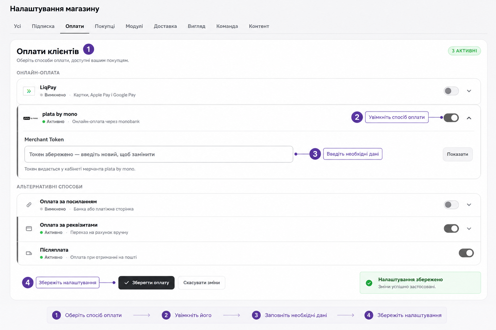

# Оплати

Магазин без робочої оплати — це вітрина. Тут зібрано все, що потрібно, щоб приймати гроші: які способи є, як їх підключити і як переконатися, що все справді працює.

!!! tip "Почніть з цього ще до налаштування магазину"
    Онлайн-еквайринг (LiqPay або Monobank) підключається на стороні банку і може зайняти кілька днів. Подайте заявку одразу, а каталог і доставку налаштовуйте паралельно — так ви не втратите тиждень на очікуванні.

---

## Які способи є

| Спосіб | Як працює | Підтвердження |
|---|---|---|
| `LiqPay` | Онлайн-еквайринг: картка, Apple Pay, Google Pay | Автоматичне |
| `plata by mono` | Онлайн-еквайринг Monobank: картка будь-якого банку, Apple Pay, Google Pay | Автоматичне |
| `Оплата за посиланням` | Покупець переходить за вашим платіжним посиланням | Ручне |
| `Оплата за реквізитами` | Переказ на рахунок за IBAN | Ручне |
| `Накладений платіж` | Оплата при отриманні посилки | — |

Усе налаштовується в одному місці:

`Керування` → `Налаштування` → `Оплати` → картка **Оплати клієнтів**

Оберіть потрібний спосіб оплати, увімкніть його та заповніть необхідні дані. Після внесення змін натисніть «Зберегти оплату»

!!! info "Скільки способів вмикати"
    Достатньо одного робочого, щоб запустити магазин. Але зв'язка «онлайн-еквайринг + накладений платіж» закриває майже всі сценарії: хто готовий платити одразу — платить, хто ще сумнівається — замовляє з післяплатою.

---

## LiqPay

### Що потрібно

Два ключі з кабінету мерчанта: `Public key` і `Private key`.

### Де їх взяти

1. Увійдіть у кабінет LiqPay або ПриватБанку для бізнесу.
2. Активуйте приймання онлайн-оплат для магазину.
3. Знайдіть `Public key` і `Private key` вашого мерчанта.

### Як підключити в магазині

1. Відкрийте `Керування` → `Налаштування` → `Оплати` → **Оплати клієнтів**.
2. Увімкніть `LiqPay`.
3. Вставте `Public key`.
4. Вставте `Private key`.
5. Натисніть `Зберегти оплату`.
6. Зробіть тестове замовлення.

---

## Monobank Merchant

У налаштуваннях магазину цей спосіб називається `plata by mono` — це та сама послуга, просто під банківською назвою.

### Крок 1. Подайте заявку

1. Перейдіть на [web.monobank.ua](https://web.monobank.ua).
2. Натисніть **Підтримка** і напишіть, що вам потрібен інтернет-еквайринг для магазину. Готовий текст — нижче.
3. Виконайте кроки, які надішле підтримка.

??? example "Готовий текст звернення в підтримку"
    Вітаю. Потрібно підключити Monobank Merchant для інтернет-еквайрингу нашого магазину.

    Ми продаємо товари онлайн і хочемо приймати оплати через Monobank Merchant.

    Підкажіть, будь ласка:

    1. який зараз порядок підключення інтернет-еквайрингу;
    2. де заповнити заявку;
    3. де після активації взяти Merchant Token для магазину.

### Крок 2. Заберіть токен

Після активації мерчанта:

1. Зайдіть у кабінет Monobank Business.
2. Відкрийте розділ **Онлайн оплата** і натисніть на назву вашого термінала.
3. Оберіть **Інтеграції** → **На мій сайт**.
4. Скопіюйте `Merchant Token`.

### Крок 3. Підключіть у магазині

1. Відкрийте `Керування` → `Налаштування` → `Оплати` → **Оплати клієнтів**.
2. Увімкніть `plata by mono`.
3. Вставте токен у поле `Merchant Token`.
4. Натисніть `Зберегти оплату`.
5. Зробіть тестове замовлення.

---

## Оплата за посиланням і за реквізитами

Ці два способи не потребують еквайрингу — але вимагають вашої участі в кожному замовленні.

| Спосіб | Що заповнити |
|---|---|
| `Оплата за посиланням` | Поле `Посилання для оплати` |
| `Оплата за реквізитами` | Поле `Текст реквізитів` |

Після оплати покупець натискає кнопку `Я оплатив(ла)`, і замовлення переходить у статус `🧾 Оплата на перевірці`. Далі ви перевіряєте надходження і тиснете `✅ Підтвердити оплату`.

!!! warning "Ці способи потребують дисципліни"
    Замовлення в статусі `🧾 Оплата на перевірці` не рухається саме по собі. Якщо ви не заглядаєте в адмінку двічі на день — клієнт сидить із оплаченим замовленням і тишею у відповідь.

---

## Накладений платіж

Оплата при отриманні. Вмикається перемикачем `Післяплата` в тій самій картці.

Замовлення з післяплатою мають власний ланцюжок статусів: `📦 Очікує відправки` → `🚚 Відправлено` → `📍 Очікує отримання` → `✅ Оплачено`.

!!! warning "Обмеження для товарів «Без ліміту залишку»"
    Якщо товар працює в режимі `Без ліміту залишку`, самого лише накладеного платежу **недостатньо** — оформлення буде заблоковане.

    Для таких товарів має бути увімкнена хоча б одна онлайн-оплата: `LiqPay`, `plata by mono`, `Оплата за посиланням` або `Оплата за реквізитами`.

    Логіка проста: товар іде під замовлення, і платформа страхує вас від відмов на етапі отримання.

---

## Що бачить покупець

У момент оформлення покупцю показуються такі варіанти:

| Що бачить покупець | Що це насправді |
|---|---|
| `💳 Оплатити онлайн через LiqPay` | LiqPay: Apple Pay, Google Pay або картка |
| `💳 Оплатити онлайн через Monobank` | Еквайринг `plata by mono`, картка будь-якого банку |
| `💳 Онлайн оплата` | Оплата за вашим посиланням |
| `🏦 Банківські реквізити` | Переказ за IBAN — позначено бейджем `IBAN` |
| `📦 Накладений платіж` | Оплата при отриманні |

Для `LiqPay` і `Monobank` після успішної оплати замовлення підтверджується **автоматично**. Для решти способів покупець тисне `Я оплатив(ла)`, а ви підтверджуєте вручну.

---

## Перевірка: чи все працює

Не покладайтеся на те, що ключі вставлені правильно. Пройдіть повний сценарій:

1. Відкрийте магазин як покупець.
2. Додайте в кошик товар з мінімальною ціною — заведіть спеціально тестовий на 1 грн.
3. Пройдіть оформлення до кінця.
4. Оплатіть реальними грошима.
5. Перевірте, що замовлення зʼявилося у вас в адмінці.
6. Перевірте, що статус став `✅ Оплачено`.

Якщо статус не змінився автоматично для LiqPay або Monobank — ключі підключені неправильно, перевірте їх ще раз.

??? question "Оплата пройшла, а статус не змінився"
    - Для `LiqPay` і `plata by mono` статус має оновитися сам. Якщо ні — перевірте, що вставлені саме бойові ключі, а не тестові.
    - Для `Оплата за посиланням` і `Оплата за реквізитами` це нормальна поведінка: підтвердження ручне.
    - Перевірте фільтр `🧾 На перевірці` — можливо, замовлення чекає саме там.

??? question "Покупець не бачить потрібного способу оплати"
    - Переконайтеся, що спосіб увімкнений і збережений кнопкою `Зберегти оплату`.
    - Перевірте режим залишків товару: для `Без ліміту залишку` накладений платіж не показується без онлайн-оплати.
    - Перевірте `Налаштування` → `Підписка` — можливо, увімкнено `Пауза checkout`.
