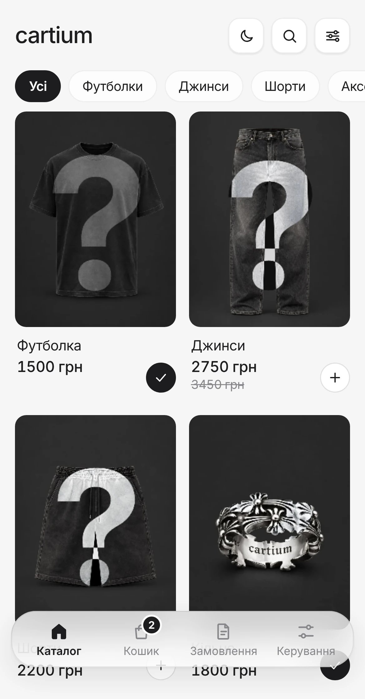
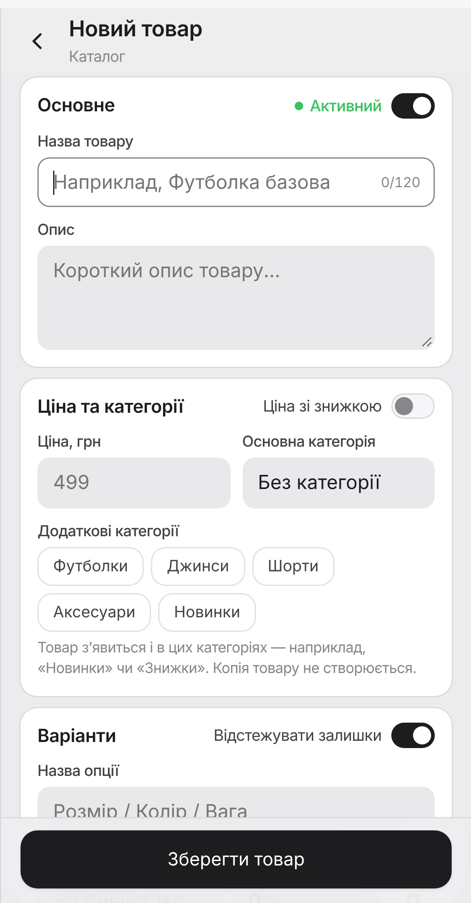
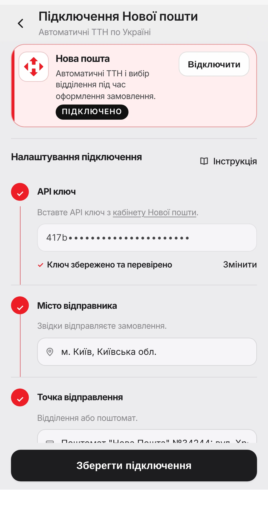
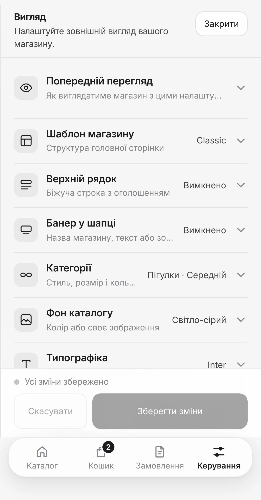
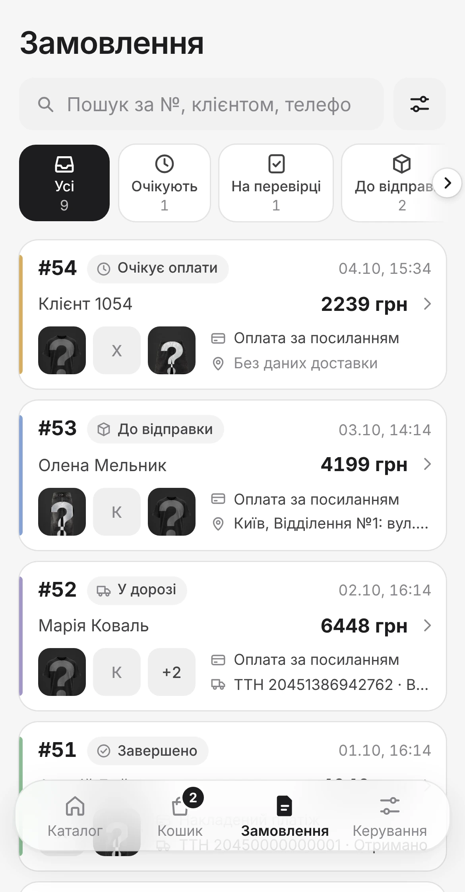

# Швидкий старт

Вісім кроків від нуля до першого замовлення. Ідіть по черзі: кожен наступний крок спирається на попередній. Разом це близько години, якщо не рахувати очікування банку.

≈ 1 год
на весь шлях

14 днів
безкоштовно, без картки

1 телефон
усе робиться в Telegram

!!! tip "Почніть з оплати, якщо плануєте LiqPay або Monobank"
    Банк перевіряє бізнес кілька днів. Подайте заявку сьогодні, а магазин налаштовуйте паралельно. Поки чекаєте, приймайте оплату за реквізитами або післяплатою. [Як підключити оплату](payments.md)

Крок 1≈ 5 хв

## Створіть магазин

Відкрийте бота [@cartium_support_bot](https://t.me/cartium_support_bot?start=connect) і натисніть `🛍️ Створити мій магазин`. Бот попросить дві речі:

1. **Назву магазину.** Її бачитимуть покупці.
2. **Токен Telegram-бота.** Через цього бота покупці замовлятимуть у вас. Створити його можна за хвилину в @BotFather, бот Cartium підкаже кожен крок.

Готово: бот пришле посилання на ваш новий магазин. Перші 14 днів безкоштовні.

??? example "Як отримати токен у @BotFather"
    1. Відкрийте @BotFather (кнопка `Відкрити @BotFather` є в повідомленні) і надішліть `/newbot`.
    2. Введіть **назву бота**, наприклад `Urban Style`. Її видно в чатах і пошуку.
    3. Введіть **username**: латиниця, цифри та `_`, від 5 до 32 символів, наприкінці обовʼязково `bot`. Наприклад, `urbanstyle_bot`.
    4. Скопіюйте токен із відповіді (рядок на кшталт `123456789:AAH…`) і надішліть його боту Cartium.

    Повідомлення з токеном бот одразу видаляє, а зберігає токен у зашифрованому вигляді. Нікому більше його не пересилайте. Для кожного магазину потрібен окремий бот.

Крок 2≈ 1 хв

## Відкрийте панель керування

Перейдіть у бота свого магазину й натисніть `Почати` (або `Start`). Ліворуч від поля введення зʼявиться кнопка `🛍 Магазин`: вона відкриває магазин усередині Telegram.

Покупці бачать тут вітрину, а ви ще й розділ `Керування` на нижній панелі. **Майже все налаштування відбувається саме там**, тому цю кнопку варто запамʼятати.

{ .phone }

Крок 3≈ 3 хв

## Створіть категорії

Категорії потрібні до товарів: так покупець знайде потрібне за два дотики, а вам не доведеться переносити товари потім.

Категорії поки створюються в чаті з ботом: надішліть `/admin` і натисніть `📂 Категорії` → `➕ Додати категорію`. Можна зробити й підкатегорії.

!!! info "Плануєте імпорт файлом?"
    Тоді цей крок можна пропустити: категорії з файлу створяться автоматично.

Крок 4≈ 15 хв

## Додайте товари

`Керування` → `Товари` → `Додати товар`

Заповніть назву, ціну, категорію й додайте фото (до 10). Розміри чи кольори заводьте **варіантами**, а не текстом в описі: тоді покупець обере їх кнопкою, а залишки рахуватимуться окремо.

Товарів десятки чи сотні? Завантажте їх одним файлом: [Імпорт каталогу](import.md).

{ .phone }

Крок 5≈ 5 хв

## Підключіть оплату

`Керування` → `Налаштування` → `Оплати`

Для старту достатньо одного способу. Найнадійніша звʼязка: онлайн-оплата карткою (LiqPay або plata by mono) плюс післяплата для тих, хто хоче оплатити при отриманні.

Увімкніть перемикач, вставте ключі й натисніть `Зберегти зміни`. Спосіб готовий, коли біля нього статус `Активний`.

[Покроково для кожного способу](payments.md){ .c-more }

{ .phone }

Крок 6≈ 5 хвPro

## Налаштуйте доставку

`Керування` → `Налаштування` → `Доставка`

Вставте API ключ із кабінету Нової пошти, виберіть зі списку місто й відділення відправлення та вкажіть свої ПІБ і телефон. Після цього ТТН створюється з картки замовлення однією кнопкою.

Відправляєте інакше? Пропустіть цей крок.

[Як отримати ключ Нової пошти](nova-poshta.md){ .c-more }

{ .phone }

Крок 7≈ 10 хв

## Оформіть вітрину

`Керування` → `Налаштування` → `Вигляд`

Оберіть шаблон, завантажте логотип і банер, підберіть колір кнопок. Кнопка `Попередній перегляд` покаже результат до збереження.

Найбільше на враження впливають якісні фото товарів і зрозумілий логотип. З них і почніть.

{ .phone }

Крок 8≈ 5 хв

## Зробіть тестове замовлення

Пройдіть увесь шлях як покупець: каталог, кошик, оформлення, оплата. Потім перевірте, що замовлення зʼявилося в розділі `Замовлення` і для онлайн-оплати отримало статус `Оплачено` автоматично.

Найпростіше завести тестовий товар за 1 грн, а після перевірки вимкнути йому перемикач `Активний`.

[Повний чекліст перед запуском](launch.md){ .c-more }

{ .phone }

## Що далі

### :ph-seal-check: Оберіть тариф
Пробний період триває 14 днів. Щоб магазин не зупинився, оберіть тариф у `Налаштування` → `Підписка`.

[Про тарифи :ph-arrow-right:](owner-guide.md#підписка){ .card-link }

### :ph-clipboard-text: Перевірте все перед запуском
Короткий чекліст, тестове замовлення і що робити в перший тиждень.

[Відкрити чекліст :ph-arrow-right:](launch.md){ .card-link }

### :ph-book-open-text: Дізнайтеся більше
Замовлення, статуси, клієнти, промокоди, аналітика: усе про щоденну роботу з магазином.

[Інструкція :ph-arrow-right:](owner-guide.md){ .card-link }

